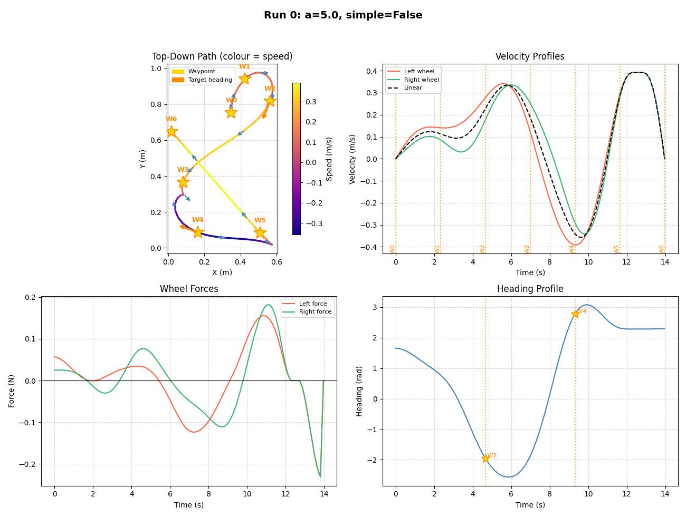

# **O**ptimal **V**elocity **E**ngine for **R**obotic **B**oundary-constrained **O**rchestration and **A**dvanced **R**amsete **D**ynamics

A trajectory optimizer for LEGO differential-drive robots in FIRST LEGO League (FLL). It generates time-optimal, physically constrained trajectories with CasADi + IPOPT, validates them before export, and ships a matching Pybricks Ramsete controller.

**📖 Technical documentation:** [docs/WHITEPAPER.md](docs/WHITEPAPER.md)

The current working tree contains uncommitted fixes for several audit items, including KI-001, KI-002, KI-003, KI-007 through KI-010, KI-013, KI-014, and KI-019 (see [KNOWN_ISSUES.md](KNOWN_ISSUES.md)). Multi-Verse refinement is still experimental: it runs, but the refined guess is discarded by the final polish (KI-004).

## Features

- **Time-optimal trajectories**: Minimizes travel time while respecting actuator and traction limits
- **Per-wheel physics model**: Velocity-dependent motor force, lateral weight transfer, per-wheel slip limits, and declared worst-case uncertainty bounds
- **Accuracy tuning**: Optional smoothness/jerk penalty to improve real-world tracking
- **Fast simple solver**: Typical sub-second CasADi/IPOPT solves on a laptop
- **Trajectory validation**: CPU forward integration, constraint audit, final-waypoint check, and Immrax interval reachability
- **Safety gate**: `--validate` blocks every output and returns exit 1 on failure
- **Controller export**: Fixed-timestep JSON for the Pybricks controller; legacy or packed-compact Python export
- **Event markers and stops**: Trigger robot actions and force rest at waypoints
- **Experimental Multi-Verse pipeline**: Reeds-Shepp bootstrap, kinematic profile, critic, and JAX refinement (currently no final quality gain, KI-004)

## Installation

### Prerequisites

- Python 3.8+
- pip

### Simple optimizer (CasADi only)

```bash
pip install -r requirements.txt
```

This installs numpy, CasADi, Plotly, Click, Matplotlib, rsplan, and websockets.

### Multi-Verse and validation

The default Multi-Verse optimizer and `--validate` also need JAX, JAXOpt, and Immrax. (`--simple --live` can run without JAX; live reachability envelopes require it.)

```bash
pip install jax jaxopt immrax pandas
```

JAX 0.6.2 was used for the current tests. These packages are not listed in `requirements.txt` yet (KI-006), so a fresh `pip install -r requirements.txt` alone can run the simple path without validation.

Use `--simple` for predictable trajectory generation:

```bash
python main.py --simple -c examples/fll_choreo.json -w examples/example_straight.json -o output.traj
```

## Quick Start

### 1. Provide a robot configuration

The recommended format is the canonical `robot` object used by `examples/fll_choreo.json`:

```json
{
  "name": "my_robot",
  "version": 4,
  "type": "Differential",
  "robot": {
    "mass": 0.723,
    "inertia": 0.001,
    "track_width": 0.0965,
    "wheel_radius": 0.028,
    "v_max_rad_s": 18.94,
    "t_max_nm": 0.138,
    "gearing": 1.0,
    "cof": 1.37,
    "gravity": 9.81,
    "torque_headroom": 0.85,
    "speed_headroom": 0.90,
    "uncertainties": {
      "cof": [1.24, 1.51],
      "torque_headroom": [0.75, 0.90],
      "gear_backlash_m": [0.0002, 0.0007],
      "inertia_kg_m2": [0.0008, 0.0011],
      "track_width_range": [0.096, 0.097],
      "wheel_radius_range": [0.0275, 0.0285]
    }
  },
  "multiverse": {
    "bootstrap": {
      "turning_radius": 0.0,
      "resolution": 0.05
    }
  }
}
```

Legacy Choreo files with a `config` object and `{ "val": ... }` entries, and flat dictionaries, are also accepted. See [docs/CONFIGURATION.md](docs/CONFIGURATION.md) for every field and the uncertainty model.

**Key parameters:**

- `mass`: Robot mass in kg (0.5-1.5 kg typical)
- `inertia`: Rotational inertia in kg·m²
- `track_width`: Distance between wheel centers in meters
- `wheel_radius`: Wheel radius in meters
- `v_max_rad_s`: Motor no-load speed in rad/s (RPM × 2π/60)
- `t_max_nm`: Motor stall torque in N·m
- `gearing`: Gear ratio (1.0 for direct drive)
- `cof`: Wheel/field friction coefficient
- `torque_headroom`, `speed_headroom`: Safety margins used by the optimizer and validator
- `uncertainties`: Ranges used by the optimizer's robust limits and by Immrax

### 2. Define waypoints

```json
[
  { "x": 0.0, "y": 0.0, "heading": 0.0 },
  { "x": 1.0, "y": 0.5, "heading": 0.5 },
  { "x": 2.0, "y": 1.0, "heading": 1.0 }
]
```

**Waypoint options:**

- `x`, `y`: Position in meters (required)
- `heading`: Heading in radians (optional; `null` means unconstrained)
- `stop`: Force the robot to rest at this waypoint (optional, default `false`)
- `event`: Event name to export at this waypoint (optional, e.g. `"lower_arm"`)
- `error_threshold`: Local reachability-envelope threshold in meters (optional)
- `precision_mode`: Shortcut for a 0.005 m envelope threshold (optional)

### 3. Generate a trajectory

```bash
python main.py --simple -c examples/fll_choreo.json -w examples/example_straight.json -o output.traj --plot
```

Remove `--simple` to run the experimental Multi-Verse pipeline. It requires JAX.

### 4. Validate and export for the controller

```bash
python main.py --simple -c examples/fll_choreo.json -w examples/example_straight.json -o output.traj \
  --validate --export-format controller --controller-dt 0.02
```

`--validate` requires JAX/Immrax even with `--simple`. It runs the CPU audit, Immrax closed-loop reachability, and the final-waypoint check before writing anything.

If you have run `pybricks_code/sysid_digital_twin.py` and fitted the logs with `sysid_fit.py`, add `--sysid-fit sysid_fit.json` to opt into the measured model. The default kinematic model is unchanged when the flag is omitted. The current integration applies the straight-line actuator gain range, first-order time constant, command delay, and odometry scale. Braking slip is loaded and reported but not applied yet because the plant has no braking state (KI-020).

The host tools are drivebase-agnostic. A minimal profile only needs wheel radius and, optionally, track width:

```json
{
  "name": "My differential drive",
  "wheel_radius_m": 0.028,
  "track_width_m": 0.0965
}
```

Use it when fitting and comparing:

```bash
python sysid_fit.py logs/session.csv --poses poses.csv \
  --profile examples/drivebase_profile.example.json --out sysid_fit.json
python sysid_compare.py output.traj poses.csv --run-id 4 \
  --profile examples/drivebase_profile.example.json
```

`--robot-config` remains supported for a full robot config, and `--wheel-radius` overrides either source. The comparator also accepts a plain predicted-pose CSV (`t,x,y,heading`) instead of a `.traj`, so it is not tied to this optimizer. It warns if the profile geometry differs from the trajectory config.

For the end-to-end profile, fit, validate, and compare walkthrough, see [docs/SYSID_QUICKSTART.md](docs/SYSID_QUICKSTART.md).

After a hardware run, compare the planned and measured stop/final poses:

```bash
python sysid_compare.py output.traj poses.csv --run-id 4
```

For a multi-stop trajectory, pass the waypoint file used to plan it, or use explicit trajectory sample indices:

```bash
python sysid_compare.py output.traj poses.csv --run-id 12 \
  --waypoints examples/example_with_stops.json
python sysid_compare.py output.traj poses.csv --stop-indices 20,40
```

The report prints position and shortest-angle heading errors and says whether each measured pose is inside the trajectory's reachability envelope. It also prints the drivebase profile and warns if its geometry differs from the trajectory config. It is a diagnostic only; it does not change the 5 mm/2 cm gate.

When validation passes, the command writes:

- `output.traj`: Full variable-timestep trajectory
- `output_controller.json`: Fixed 20 ms controller profile
- `output.py` instead of the controller file when `--export-format python` is used
- `output.py` packed trajectory module when `--export-format python-compact` is used; import it with `pybricks_code/ramsete_compact.py` (or `ramsete_compact_events.py` for events)

> **Safety note:** if validation fails, the command prints the reason, exits 1, and writes no trajectory, controller, Python file, or stats. A pre-existing file at the output path is left untouched. The straight example and the complex mission pass under the current narrowed test ranges; the S-curve, stops, and events examples still fail the Immrax gate (KI-020), so always check the exit code.

### 5. Live visualization (optional)

```bash
python main.py --simple -c examples/fll_choreo.json -w examples/example_complex_mission.json --live
```

Open `viz/index.html` in a browser. The server is blocking and exits when you press Enter.

> **Known limitations:** `--live` kills whatever owns port 8765 (KI-005), and the first client does not receive the robot config or waypoints (KI-016). Only the final trajectory is reliable.

## CLI Options

```text
Usage: main.py [OPTIONS]

Options:
  -c, --config PATH              Path to the configuration file (.json). [required]
  -w, --waypoints PATH           Path to waypoints JSON file. [required]
  -o, --output TEXT              Output trajectory file path. [default: output.traj]
  -n, --samples INTEGER          Samples per segment. [default: 10]
  -a, --accuracy-weight FLOAT    Smoothness/accuracy weight (0 = pure time-optimal). [default: 0.0]
  --candidates INTEGER RANGE     Candidates to solve and compare with --validate. With --simple,
                                 distinct initial-guess seeds (baseline, rolling, bow_left, bow_right,
                                 turn_first); the Multi-Verse path uses accuracy_weight steps of 2.0.
                                 [default: 2; 1<=x<=5]
  --stop-waypoints TEXT          Comma-separated waypoint indices where the robot must stop.
  --events TEXT                  Comma-separated waypoint:event pairs.
  --simple                       Use the CasADi-only optimizer instead of Multi-Verse.
  --per-segment-dt               Allow each waypoint segment its own sample interval (--simple only).
  --no-parallel                  Disable Multi-Verse parallelism (currently no effect on the result).
  --workers INTEGER              Multi-Verse worker count (currently no effect on the result).
  --validate                     Run the CPU + Immrax gate; block export on failure. Requires JAX.
  --sysid-fit PATH               Optional measured digital-twin fit; requires --validate or --live.
  --export-format [none|controller|python|python-compact]
  --controller-dt FLOAT          Controller export timestep in seconds. [default: 0.02]
  --benchmark                    Write <output>_stats.json after a successful export.
  --plot                         Show the trajectory plot (blocking GUI).
  --animate                      Animate the trajectory (blocking GUI).
  --live                         Start the live WebSocket view (blocking; see KI-005/KI-016).
  --show-convergence             Plot convergence for the simple optimizer.
  --convergence-mode [parallel|best|layered]
  --convergence-animate          Parsed but currently unused (KI-017).
  --convergence-output TEXT      Parsed but currently unused (KI-017).
  -q, --quiet                    Suppress progress output.
```

## Project Structure

```text
Project-O.V.E.R.B.O.A.R.D/
├── main.py                    # CLI entry point and export gate
├── optimizer.py               # CasADi + IPOPT trajectory optimizer
├── multiverse_optimizer.py    # Experimental Multi-Verse pipeline
├── robot_model.py             # Config parsing, force model, per-wheel constraints
├── validator.py               # CPU forward integration and constraint audit
├── immrax_validator.py        # Closed-loop interval reachability validator
├── digital_twin.py            # Optional sysid_fit.json model loader
├── sysid_fit.py               # Host-side fitter for robot SysId logs
├── sysid_compare.py           # Planned-vs-measured stop/final pose report
├── jax_robot_model.py         # JAX robot model
├── jax_ramsete.py             # JAX Ramsete parity / interval controller
├── jax_optimizer.py           # JAX candidate generation and refinement
├── export.py                  # Controller JSON and Python export
├── plotter.py                 # Trajectory and envelope plots
├── animated_plotter.py        # Trajectory animation
├── convergence_plotter.py     # Convergence plots
├── live_visualizer.py         # WebSocket live view
├── path_planning.py           # Reeds-Shepp path utilities
├── tests/                     # unittest suite
├── examples/                  # Example configs and waypoint files
├── pybricks_code/             # Pybricks robot controller code
├── viz/                       # Browser live-view UI
└── docs/                      # Configuration, examples, API, whitepaper
```

## How It Works

The simple optimizer solves a direct-collocation optimal-control problem:

1. **Discretization**: Each segment is divided into samples; the decision variables include the timestep and the pose/wheel speeds at every sample. By default all segments share one timestep; `--per-segment-dt` (with `--simple`) gives each segment its own interval.
2. **Objective**: Minimize total time, plus an optional jerk/smoothness penalty controlled by `--accuracy-weight`.
3. **Constraints**:
   - Trapezoidal kinematic integration
   - Waypoint position constraints and optional heading constraints
   - Start, end, and intermediate stop constraints
   - Per-wheel torque-speed limits
   - Per-wheel normal force with lateral weight transfer
   - Per-wheel traction limits
   - Worst-case force bounds over the declared uncertainty ranges
4. **Solve**: IPOPT finds a locally optimal trajectory. The result is converted to Choreo v3 samples.

The simple solver is deterministic and is the recommended path for current use.

### Multi-Verse Refinement

The default pipeline is:

1. **Bootstrap**: Reeds-Shepp geometry.
2. **Kinematic profile**: Convert geometry into a time series.
3. **Critic**: Flag bad windows with six metrics (tortuosity, yaw excess, chattering, jerk, curvature, centripetal cost).
4. **JAX refinement**: Generate candidates for flagged windows and refine them with JAX.
5. **CasADi polish**: Re-solve the global problem with IPOPT.

The refinement phase updates an intermediate trajectory, but `_global_solve` builds a warm-start guess and never passes it to `TrajectoryOptimizer.solve` (KI-004). The final polish therefore starts from the same default initial guess as `--simple`. `--workers`/`--no-parallel` also have no effect on the result. A measured 3-waypoint pipeline benchmark produced the same 6.7614 s trajectory with simple and Multi-Verse, and 0.00 % cost improvement.

## Common Usage Patterns

### Simple straight line

```bash
python main.py --simple -c examples/fll_choreo.json -w examples/example_straight.json -o straight.traj --plot
```

### Path with turns

```bash
python main.py --simple -c examples/fll_choreo.json -w examples/example_s_curve.json -o s_curve.traj --plot
```

This path generates output, but it currently fails `--validate` (KI-020).

### Mission with stops and events

```bash
python main.py -c examples/fll_choreo.json -w examples/example_complete.json -o mission.traj \
  --export-format controller --controller-dt 0.02 --plot
```

Add `--validate` if you want the safety gate; check the exit code, because some multi-waypoint paths still fail the Immrax gate (KI-020).

### Smooth trajectory for better tracking

```bash
python main.py --simple -c examples/fll_choreo.json -w examples/example_s_curve.json -o smooth.traj \
  -a 1.0 --plot
```

### Full suite (experimental)

```bash
python main.py -c examples/fll_choreo.json -w waypoints.json -o mission.traj \
  -a 1.0 --benchmark --validate --export-format controller \
  --show-convergence
```

- `-a 1.0`: Smoothness priority
- `--benchmark`: Quality/telemetry stats after the export gate
- `--validate`: CPU + Immrax gate
- `--show-convergence`: Convergence plot for the simple optimizer
- `--live`/`--workers`/`--convergence-animate` are not quality controls in the current tree

## Accuracy vs. Speed Tradeoff

By default the optimizer is purely time-optimal (`--accuracy-weight 0.0`). This is the fastest solution but can demand rapid acceleration changes. Increasing `--accuracy-weight` adds a jerk penalty and trades time for smoother wheel commands:

- `0.0`: Pure time-optimal
- `0.5-1.0`: Balanced smoothness
- `2.0+`: Very smooth, with a larger time cost

The exact tradeoff depends on the path and robot. Measure it on your own trajectory rather than relying on a fixed percentage.

With `--validate`, the tradeoff is measured, not assumed: `--candidates N` (default 2, max 5) solves N candidates, validates and scores every one, and keeps a passing candidate with the smallest Immrax envelope, with the shortest trajectory breaking ties. With `--simple` the candidates are distinct initial-guess seeds at the same base accuracy weight: `baseline` (linear, zero-speed guess), `rolling`, `bow_left`, `bow_right`, and `turn_first`. The Multi-Verse path has no seed plumbing yet, so it keeps the historical `accuracy_weight` ladder (`base`, `base + 2.0`, ...). `--candidates 1` disables the comparison. A slower or differently shaped candidate that scores worse is discarded; nothing is escalated silently.

`--per-segment-dt` (with `--simple`) is an opt-in structural variant, not a silent default. It gives each waypoint segment its own interval length. On an uneven 1.0 m + 0.2 m path it passes at 2.710 s versus 4.463 s uniform, with a slightly smaller envelope (0.32 vs 0.35 cm). On the complex mission at `--accuracy-weight 0` it is faster (5.447 s) but tracking is 0.86 cm, above the 5 mm gate, so it is rejected; at `0.02` it passes at 7.312 s / 1.61 cm, which is slower and wider than the uniform 6.068 s / 1.22 cm baseline. The default therefore stays uniform until a timing mode is selected and validated per path.

## Output Format

```json
{
  "name": "output",
  "version": 3,
  "trajectory": {
    "config": { "mass": 0.723, "track_width": 0.0965, "...": "..." },
    "samples": [
      {
        "t": 0.0,
        "x": 0.0,
        "y": 0.0,
        "heading": 0.0,
        "vl": 0.0,
        "vr": 0.0,
        "omega": 0.0,
        "al": 0.0,
        "ar": 0.0,
        "fl": 0.0,
        "fr": 0.0
      }
    ]
  }
}
```

Samples may also contain `event` and `reachability_envelope`. The validator, exporter, plotters, and Pybricks runtime consume this schema; keep it stable.

## Validation

`--validate` performs three independent checks:

1. **CPU audit**: per-wheel motor force, per-wheel slip, total traction, and wheel-speed limits at every sample.
2. **Forward integration**: RK4 at 1 ms against the planned trajectory; max and final position errors must be under 1 cm.
3. **Immrax reachability**: closed-loop Ramsete with interval parameters, a linear reference, a 20 ms sample-and-hold controller, and 5 ms plant substeps. It reports tracking error and envelope radius separately; transit samples use a 2 cm envelope threshold, and precision waypoints use their local threshold.

With `--sysid-fit`, the Immrax plant switches from the default three-state kinematic model to a five-state model with actual wheel speeds. The fitted straight-line gain is an interval, the time constant is a first-order lag, the delay is applied to the held command, and the odometry distance/heading scales are applied to the feedback pose. The fit is optional and disabled by default; without it, the default path is unchanged.

The final pose is also checked against the last waypoint. If any check fails, the CLI exits 1 and writes nothing.

With `--validate`, `--candidates N` (default 2, max 5) solves N trajectories. With `--simple`, each is a different initial-guess seed at the same `accuracy_weight`; otherwise the Multi-Verse path uses `accuracy_weight`, `accuracy_weight + 2.0`, and so on. Every candidate is validated; the selected one is the passing candidate with the smallest envelope, with the shortest trajectory breaking ties. If none pass, the candidate closest to passing is selected for reporting but still blocked from export. Without `--validate`, only the first candidate is solved.

**Measured current examples** (model predictions, not hardware):

| Case | Result |
|---|---|
| Straight, `--simple --validate` | PASS; selected 2.377 s trajectory, about 0.06 s selected-candidate solve, 0.000407 m max integration error, envelope 0.28 cm, zero motor/slip violations (all five seeds converge to the same optimum) |
| First 4 mission waypoints, `--simple --validate` | PASS; selected 2.176 s, envelope 0.27 cm; the other seeds take 2.56-2.72 s with 0.28-0.29 cm |
| S-curve | FAIL; selected 3.696 s, envelope 0.77 cm, tracking 1.32 cm (candidate 2 rolling: 3.788 s, 0.75 cm / 1.47 cm) |
| Stops | FAIL; selected 6.246 s, envelope 0.95 cm, tracking 0.52 cm (candidate 1 baseline: 6.246 s, 0.93 cm / 0.60 cm) |
| Events | FAIL; selected 4.636 s, envelope 0.97 cm, tracking 0.53 cm (candidate 1 baseline: 4.637 s, 0.97 cm / 0.54 cm) |
| Complex mission | PASS; selected 6.068 s, envelope 1.22 cm, tracking 0.49 cm; the other four seeds take 8.1-8.7 s with 1.55-1.76 cm envelopes |
| Uneven test path (1.0 + 0.2 m), `--per-segment-dt` | PASS; 2.710 s, envelope 0.32 cm, tracking 0.36 cm; uniform: 4.463 s, 0.35 cm / 0.36 cm |

All of the failing commands exit 1 and write no output. This is the gate working, not a crash. These results use the narrowed `track_width_range` and `gear_backlash_m` in `examples/fll_choreo.json`; those are test assumptions, not measured hardware values. Without a hardware fit the validator is still kinematic; `--sysid-fit` adds the measured actuator/odometry model, but the thresholds are unchanged. See KI-020.

## Controller Export

`--export-format controller` writes `<output>_controller.json`:

- Fixed timestep, default 20 ms
- Samples contain `t, x, y, heading, vl, vr, v, omega`, plus `event` when one is assigned
- Ready for `pybricks_code/ramsete_fast.py` or another trajectory follower

`--export-format python` writes `<output>.py` containing a `config` dictionary and the `samples` list for direct import by `ramsete_fast.py` or `ramsete.py`.

`--export-format python-compact` writes a Pybricks module with a packed `samples` bytes object (4-byte header plus 24 bytes per sample), a `config` dictionary, and an `events` tuple. Use `pybricks_code/ramsete_compact.py` for pathing or `ramsete_compact_events.py` for event missions. The compact controllers are available but are not wired into the existing `robot.py` menu or missions.

## Performance

Measured on the current working tree with the example config:

- 1 m straight, simple optimizer: about **0.06 s** solve wall time, **2.377 s** trajectory time, **0.000407 m** max forward-integration error.
- 3-waypoint pipeline benchmark: simple **0.1076 s**, Multi-Verse **0.1224 s**, both with a **6.7614 s** trajectory and **0.00 %** improvement.
- Multi-Verse refinement phase: about **0.0115 s**, but its result is not used by the final polish.

`--validate` adds the Immrax reachability pass and, by default, solves two candidates, so validation runs take longer than a raw single solve. There are no verified hardware timing numbers in this repository yet.

### Example Trajectory



This historical plot is kept for visualization. It is not a current Multi-Verse quality claim.

## Research & References

See [docs/trajectory_tools_research.md](docs/trajectory_tools_research.md) for comparisons with Choreo, PathPlanner, and CasADi, plus academic references.

## Development Status

- ✅ Phase 1: CasADi + IPOPT solver
- ✅ Phase 2: Time vs. accuracy tradeoff
- ✅ Phase 3: Validation and controller export (with a hard export gate)
- 🟡 Phase 4: Multi-Verse pipeline implemented but refinement discarded (KI-004)
- 🟡 Phase 5: Events and stops implemented; final-waypoint event bug remains (KI-012)
- ⚪ Phase 6: Field geometry/obstacle constraints (optional)
- 🟡 Digital twin: parity, gate, and optional fitted actuator/odometry model implemented; motor/DriveBase/slip dynamics remain (KI-020)

## Additional Documentation

- **[docs/CONFIGURATION.md](docs/CONFIGURATION.md)**: Configuration schema, uncertainty ranges, waypoints, CLI
- **[docs/EXAMPLES.md](docs/EXAMPLES.md)**: Usage examples and troubleshooting
- **[docs/API_robot_model.md](docs/API_robot_model.md)**: Robot model and force-model API
- **[docs/API_validator_export.md](docs/API_validator_export.md)**: Validator and export API
- **[docs/WHITEPAPER.md](docs/WHITEPAPER.md)**: Current-state technical description
- **[KNOWN_ISSUES.md](KNOWN_ISSUES.md)**: Open and fixed issues

## Pybricks Integration

The `pybricks_code/` directory contains the robot-side controller:

- `ramsete_fast.py`: Pathing controller used by `mission_4_ramsete.py` (50 Hz loop)
- `ramsete.py`: Event-capable reference controller used by `mission_5_lambdas.py`
- `ramsete_compact.py`, `ramsete_compact_events.py`: Packed-trajectory controllers for `--export-format python-compact`; available but not wired into the existing missions
- `robot.py`, `robot_config.py`: Hub menu and hardware definitions
- `mission_*.py`: Example mission scripts
- `plot_tracking.py`: Tracking visualization

**Known limitation:** an event on the final waypoint is exported but not fired by the deployed loop (KI-012). Trigger the final action after `follow_trajectory` returns, or use `ramsete.py` if you need the reference event path.

See [pybricks_code/README.md](pybricks_code/README.md) for setup instructions.

## License

This project is for FLL educational use.
