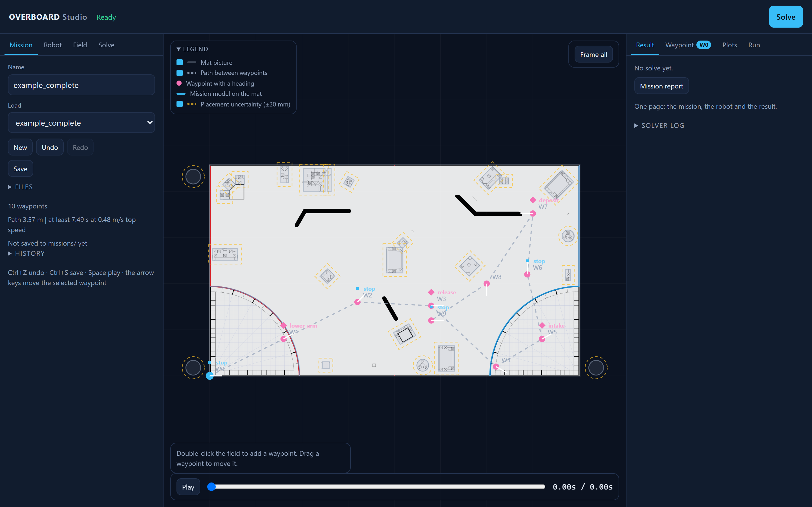
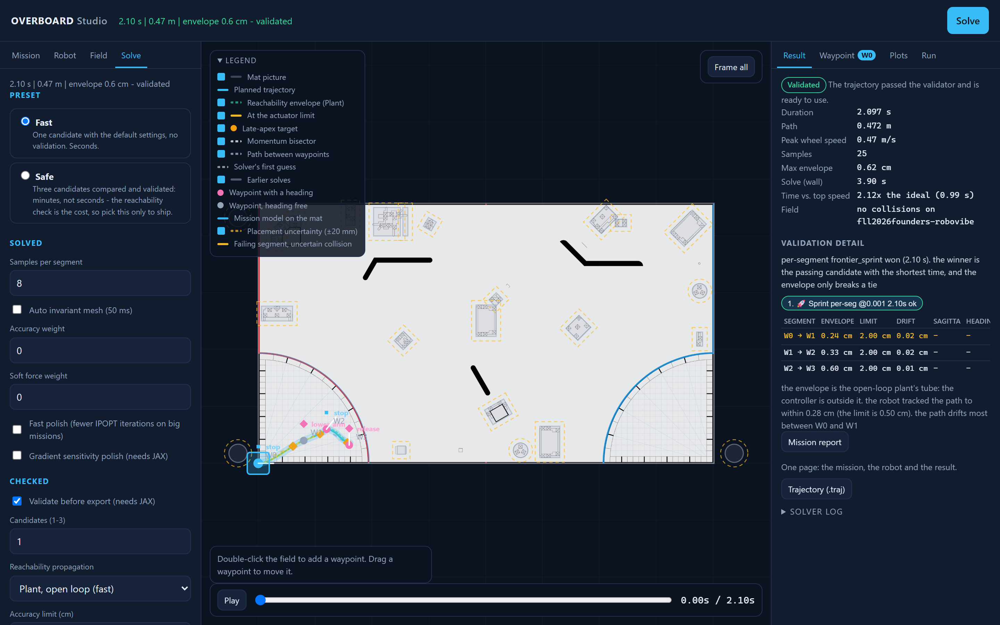

# **O**ptimal **V**elocity **E**ngine for **R**obotic **B**oundary-constrained **O**rchestration and **A**dvanced **R**amsete **D**ynamics

A trajectory optimizer for LEGO differential-drive robots in FIRST LEGO League. It
plans time-optimal motion under a per-wheel force model with CasADi + IPOPT,
checks the plan against a reachability model before letting it leave the machine,
and ships the matching Pybricks Ramsete controller.

```
mission JSON  ->  3-Pillar planner  ->  CasADi/IPOPT  ->  validation gate  ->  .traj + controller  ->  hub
                                          (solve)        (CPU audit + Immrax)      (export)          (run)
```

Same program, two front ends: this command line, and the browser studio (`--gui`)
that draws the mission on the field and runs the identical pipeline behind it.

**Alpha `0.1.0a2`** · [CHANGELOG](CHANGELOG.md) · [Known issues](KNOWN_ISSUES.md) · [What we claim, and what stands behind it](CLAIMS.md)

*Working with an AI coding agent? `AGENTS.md` is the short index of the rules and
commands; the documents linked below are the long form.*

## Status and limits

The planner, the validator and the controller export work end to end. The robot
side is **not** yet validated against a calibrated drivebase (KI-020), so a
passing plan is a model prediction, not a guarantee on the field. Calibrate the
drivebase before trusting the envelope.

Three items are open, everything else in the audit is fixed or mitigated:

| ID | What it means for you |
|---|---|
| **KI-020** | The validator is not a full digital twin. Motor, odometry, slip and DriveBase dynamics are only partly modelled. |
| **KI-054** | The envelope gate compares an absolute radius against a tube that grows with path length, so a long path can fail for being long. `--envelope-limit-per-metre` is the lever. |
| **KI-055** | The gate returns a verdict, not a score: it refuses a mission it cannot approve rather than ranking it. |

## Install

Three steps, no Python knowledge needed.

### 1. Get the code

```bash
git clone https://github.com/thebuilder6/Project-O.V.E.R.B.O.A.R.D.git
cd Project-O.V.E.R.B.O.A.R.D
```

Without git: **Code → Download ZIP** on the project page, then unzip. Everything
below works from the unzipped folder.

### 2. Install

Double-click **`install.bat`** (Windows) or run **`sh install.sh`**
(macOS/Linux). It creates a private `.venv`, installs the solver and the studio
into it, then checks the result. Safe to run again: the existing `.venv` is
reused.

You need **Python 3.9 or newer**. If the script says Python was not found,
install it from [python.org](https://www.python.org/downloads/) and tick **Add
python.exe to PATH**, then run the script again. On 3.9 the optional stack is
skipped, because JAX has no wheel for it — install 3.10 or newer if you want
`--validate`.

### 3. Start the studio

Double-click **`start_studio.bat`** (Windows) or run **`sh start_studio.sh`**
(macOS/Linux). Your browser opens on the studio: draw a mission on the field,
press **Solve**, download the trajectory or the controller file. The script
installs the virtual environment itself, so on a fresh download you can skip
step 2.

The terminal runs the same program:

```bash
.venv\Scripts\python -m overboard.main --gui     # Windows
.venv/bin/python -m overboard.main --gui         # macOS/Linux
```

A `v*` tag also builds a standalone desktop build — a one-folder app with the
studio, the solver and JAX, as a Windows installer plus macOS and Linux archives
— and attaches it to the release, so a machine without Python can run the
studio. It is built by `.github/workflows/desktop.yml` from
`overboard_desktop.py`. In that build the `missions/`, `calibration/` and
`mats/` folders live in a writable state directory, not next to the read-only
program. The app carries its own manual - **Help** in the studio - and copies
these documents into `docs/` in that state directory on first run, so it explains
itself on a machine that never saw the repository.

### If something is missing

```bash
python -m overboard.main --doctor
```

It prints the Python version, every package, the example files, the output
directory and the studio's ports, with the exact command that fixes anything
missing.

### Manual install, if you would rather

```bash
python -m venv .venv
.venv\Scripts\python -m pip install -r requirements.txt   # Windows
.venv/bin/python -m pip install -r requirements.txt       # macOS/Linux
```

`requirements.txt` is numpy, CasADi, Plotly, Click and Matplotlib: enough for
the solver and the studio. `--validate` and `--push-hub` also need
`requirements-optional.txt` (JAX + Immrax, pinned to the pair the test suite
runs against, plus `pybricksdev` for the hub). Every command runs as
`python -m overboard.…` from the repository root; there is no package on PyPI.

## First trajectory

### 1. Describe the robot

The canonical format is the `robot` object used by `examples/fll_choreo.json`:

```json
{
  "name": "my_robot",
  "version": 4,
  "type": "Differential",
  "robot": {
    "mass": 0.723,
    "inertia": 0.0024,
    "track_width": 0.0965,
    "wheel_radius": 0.028,
    "v_max_rad_s": 18.94,
    "t_max_nm": 0.138,
    "gearing": 1.0,
    "cof": 0.95,
    "gravity": 9.81,
    "torque_headroom": 0.85,
    "speed_headroom": 0.90,
    "uncertainties": {
      "cof": [0.85, 1.05],
      "torque_headroom": [0.75, 0.90],
      "gear_backlash_m": [0.0002, 0.0008],
      "inertia_kg_m2": [0.0020, 0.0028],
      "track_width_range": [0.096, 0.097],
      "wheel_radius_range": [0.0275, 0.0285]
    }
  }
}
```

Legacy Choreo files with a `config` object and `{"val": ...}` entries, and flat
dictionaries, parse identically. [docs/CONFIGURATION.md](docs/CONFIGURATION.md)
has every field and the uncertainty model.

| Field | Meaning |
|---|---|
| `mass`, `inertia` | kg, kg·m² |
| `track_width`, `wheel_radius` | metres between wheel centres, metres |
| `v_max_rad_s`, `t_max_nm` | motor no-load speed (RPM × 2π/60) and stall torque |
| `gearing` | gear ratio, `1.0` for direct drive |
| `cof` | wheel/field friction coefficient |
| `torque_headroom`, `speed_headroom` | safety margins used by both the optimizer and the validator |
| `uncertainties` | ranges the robust limits and the reachability check plan against |

Without `-c`, the example robot is used and the CLI says so.

### 2. Describe the mission

A waypoint file is a plain list:

```json
[
  {"x": 0.0, "y": 0.0, "heading": 0.0},
  {"x": 1.0, "y": 0.5, "heading": 0.5, "event": "lower_arm"},
  {"x": 2.0, "y": 1.0, "heading": null, "stop": true}
]
```

- `x`, `y` — metres, required.
- `heading` — radians, optional; `null` means unconstrained.
- `stop` — force the robot to rest here (default `false`).
- `event` — name the exported controller fires here (e.g. `"lower_arm"`). An
  event on the final waypoint fires after the loop, once the drivebase has
  stopped.
- `error_threshold` — local reachability-envelope limit in metres, applied to
  the segment that *ends* here.
- `precision_mode` — shortcut for a 5 mm envelope threshold.

### 3. Solve

```bash
python -m overboard.main -w examples/example_straight.json -o output.traj
```

```
duration 2.299 s | path 1.000 m | peak wheel speed 0.47 m/s | 19 samples
validation: not run - add --validate before driving this robot
```

The 3-Pillar unified planner is the only planner, so no extra flag is needed: it
supplies the candidate set and the mesh, and CasADi/IPOPT is the backend it
drives.

### 4. Validate, then export for the controller

```bash
python -m overboard.main -w examples/example_straight.json -o output.traj \
  --validate --export-format controller --controller-dt 0.02
```

`--preset safe` is the one-flag version of the same thing: three candidates,
`--validate` with the closed-loop tick propagation, and a controller export.

```bash
python -m overboard.main -w examples/example_straight.json --preset safe -o output.traj
```

When the gate passes, the run writes:

| File | Contents |
|---|---|
| `output.traj` | Choreo v3 trajectory, variable timestep |
| `output_controller.json` | fixed-timestep controller profile (20 ms default) |
| `output.py` | Python module (`--export-format python`), or the packed module (`python-compact`) |
| `output_stats.json` | with `--benchmark` |
| the file you name with `--candidates-out` | every solved candidate: seed, verdict, score, samples |

> **The gate is hard.** If validation fails, the reason is printed, the exit code
> is 1, and no `.traj`, controller, Python file or stats is written. A
> pre-existing file at the output path is left untouched. Which example missions
> pass is a measurement, not a promise; always check the exit code.

## Validation

`--validate` (JAX + Immrax) runs three independent checks on every candidate:

1. **CPU audit** — per-wheel motor force, per-wheel slip, total traction and
   wheel-speed limits at every sample.
2. **Forward integration** — RK4 at 1 ms against the planned trajectory; max and
   final position error must stay under 1 cm.
3. **Immrax reachability** — the closed-loop Ramsete controller with interval
   parameters, a 20 ms sample-and-hold and 5 ms plant substeps. Tracking error
   and envelope radius are reported separately; transit samples use a 2 cm
   envelope budget, precision waypoints their local threshold.

The final pose is also checked against the last waypoint.

**What the gate costs and what it decides.** Without `--validate`, only the first
candidate is solved. With it, `--candidates N` (default 2) solves N of the
planner's three frontier candidates (in parallel), audits and validates each one,
and selects a passing candidate: the **fastest**, with the envelope breaking a
duration tie. The 5-part path fitness score (stop spread, slip risk, RMS wheel
force, tracking error, run time) is reported for every candidate so the rule can
be re-run offline, but it does not decide. The CPU audit runs on every candidate,
not only the winner. If none pass, the closest one is reported and the export is
still blocked. `--pick-candidate N` exports a specific passing candidate.

**Accuracy failures can be exported deliberately.** `--best-effort` writes the
best converged candidate when the *only* failure is an accuracy excess (envelope
or tracking). The `.traj` root and `_stats.json` both carry
`validation: {passed: false, best_effort: true, ...}`, and the file is not
approved for the hub. A force, slip, integration, divergence or non-convergence
failure still writes nothing.

**The envelope limit.** `--envelope-limit METRES` (0.001–0.05, default 0.02) is
the run-wide budget; a waypoint's `error_threshold` wins over it, and the limit
in force is recorded in the report and in the file. It is absolute by default, so
a long path can fail for being long (KI-054);
`--envelope-limit-per-metre M/M` (default 0, max 0.05) adds that much allowance
per metre travelled.

**Which propagation.** `--propagation plant` (the default) propagates the plant
open-loop with the controller evaluated outside the tube. `--propagation tick`
embeds one closed-loop control tick — controller, pose estimate and delayed
command inside the map — so the tube contracts the way the robot's does. It needs
a Jacobian inclusion and costs 7–10× the validation time. An envelope is never
read without its model: every candidate carries `propagation` and `inclusion`.

**A machine-readable verdict.** With `--validate`, one line per run goes to
stdout: `##OVERBOARD-VALIDATION## {json}` with the per-candidate and per-segment
envelope, limit, drift, reasons, the accuracy weight and the score vector
(`duration_s`, `envelope_cm`, `tracking_cm`, `max_excess_cm`, `peak_jerk_m_s3`,
`fitness_s` and its parts). Nothing is written to disk on a failed validation,
so the report goes to stdout only.

**A measured model, if you have one.** `--sysid-fit sysid_fit.json` switches the
validator from the default kinematic model to the fitted one: the straight-line
gain as an interval, a first-order lag, command delay, odometry scales and the
measured brake shortfall, with the motor's stall torque and no-load speed taken
out of the declared config so every tool plans against the same motor. Omitted,
nothing changes. See [docs/research/RQ-B_drivetrain_model.md](docs/research/RQ-B_drivetrain_model.md).

## The browser studio

```bash
python -m overboard.main --gui
```

Or `start_studio.bat` / `sh start_studio.sh`. The server blocks until you stop it
with Ctrl+C, and never takes a port from another program: if 8000 is busy it
moves to the next free one (`--gui-port` to choose).



**The five-minute tour**

1. **Load or draw the mission.** Every example and saved mission is in the
   **Mission** tab's list; picking one replaces what is on the field.
   Double-click the field to add a waypoint, drag one to move it, and use the
   **Waypoint** tab for its exact x/y, heading, stop and event.
2. **Set the robot.** The **Robot** tab holds the config, the geometry and the
   uncertainty ranges the validator plans for. If the plan's wheel or track
   differs from the robot's, the tab says so and offers to copy the robot's.
3. **Choose how hard to check.** **Fast** solves one candidate with no
   validation, in seconds. **Safe** compares the three frontier candidates and
   validates them: minutes, not seconds, because the reachability check is the
   cost — pick it only to ship.
4. **Solve.** The header carries the answer whatever tab you are on:
   `12.4 s | 3.7 m - not validated` for the fast preset, or the same line ending
   `- validated` once the check has run.
5. **Read the result.** The **Result** tab has the numbers, the envelope, the
   per-segment table and, when a check fails, the reason and the segment that
   failed, marked in red on the field. The **Plots** tab draws the profiles from
   the same samples.
6. **Write the files.** The **Result** tab downloads the `.traj`, the controller
   JSON, the Python module, the stats and the one-page mission report. A
   validated plan can then be pushed from the **Run** tab.



The page is three columns. The left one is what you set (**Mission**, **Robot**,
**Field**, **Solve**), the canvas in the middle is the work, the right one is
what you read (**Result**, **Waypoint**, **Plots**, **Run**). The header line
always carries the result, so a tabbed column can never hide the answer. Every
control is listed in [docs/STUDIO_UI_INVENTORY.md](docs/STUDIO_UI_INVENTORY.md).

**The field.** The **Field** block picks the season: the mission models come from
`fields/<season>.json`, measured off FIRST's public wireframe, and the mat's
picture is the one you bring (FIRST's artwork is not ours to ship; the studio can
download it on request into `mats/`, outside the repository). After a solve the
server reports where the path ran into a mission model, and the studio marks those
places on the field. Nothing is planned around them: they are marked so you can
decide. A collision shallower than the field's placement uncertainty (50 mm) is
reported as uncertain rather than as a hit. Provenance:
[research/field_maps/README.md](research/field_maps/README.md).

**When a check fails, the studio says where.** A row per path segment with the
envelope, the local limit and the drift; the failing segment marked on the field;
and the reason the gate gave. Under the table it names the lever that might fix
it — the tick propagation, the gradient polish, the soft force weight, or a
smaller accuracy weight — and each one is a button that re-solves.

**It runs the same command line.** The export gate, the validation rules and the
file formats are identical to the terminal path. A plan that failed on accuracy
alone stays on the field marked *Failed validation*, never approved for the hub.

**Your work is never lost.** Every edit can be undone (Ctrl+Z / Ctrl+Shift+Z),
the robot config included; the mission is kept in the browser and comes back
after a reload; **Download** saves a copy; **Save** writes it to `missions/`.
That folder is its own git repository, so **History** shows every saved version
and can put one back, without touching this repository. Arrow keys nudge the
selected waypoint (1 cm; Shift 10 cm, Alt 1 mm).

**Project file.** One file with the mission, the robot config, the solve options,
the measured model and the field. Send it to a team-mate and they open the whole
setup, not just the path.

**Mission report.** One button writes a single printable page — the mission, the
robot and the result, with the planned path and the wheel speeds drawn — next to
the trajectory, built from the same numbers the studio shows.

## Accuracy vs. Speed Tradeoff

By default the optimizer is purely time-optimal (`--accuracy-weight 0.0`). This
is the fastest solution but can demand rapid changes in acceleration. Increasing
`--accuracy-weight` adds a jerk penalty and trades time for smoother wheel
commands. The weight has no upper bound; what matters is the scale it is on:

- `0.0`: pure time-optimal. On some missions this misses the motor-force gate.
- `0.001-0.002`: the range the candidate set uses, and the cheapest lever there
  is. The same seed that fails at 0 passes at 0.001.
- `0.005-0.01`: smoother still. Beyond this the time cost grows without buying
  passes, and the best weight differs per mission.

Measure it on your own trajectory rather than trusting a fixed number.

### Where the timing may change

Every candidate uses the per-segment timing model, which is held to the
wheel-jerk discipline (KI-024). A waypoint is a legitimate **timing boundary**
only when the robot stops there *and* the heading is pinned; elsewhere the pieces
stay linked and must agree on the state:

| waypoint | what the two pieces must agree on |
|---|---|
| stop and pinned heading | nothing — the state is fully determined |
| pinned heading, no stop | the wheel velocities there |
| stop, no pinned heading | the heading there; the velocity is zero on both sides |
| neither | the heading and the wheel velocities |

Because the path is one NLP over one shared variable set, the state agreement is
automatic. What per-segment timing could break is the *reading* of the motion
profile: the acceleration before a waypoint is `(vl[k]-vl[k-1])/dt_prev` and the
one after it is `(vl[k+1]-vl[k])/dt_next`, so a change of interval across the
waypoint re-reads the same velocity ramp as two different accelerations and puts
a step in the wheel force profile exactly there. The per-segment model therefore
requires the wheel acceleration — and so the wheel force — to be continuous
through every waypoint the robot does not stop at. A stop is exempt, because the
force has to reverse sign there anyway.

## How it works

The optimizer solves a direct-collocation optimal-control problem:

1. **Discretisation** — each segment is divided into samples; the decision
   variables include the timestep and the pose/wheel speeds at every sample.
   Every candidate uses the per-segment formulation, so each segment has its own
   sample interval.
2. **Objective** — total time, plus an optional jerk/smoothness penalty from
   `--accuracy-weight` and an optional wheel-force utilisation price from
   `--force-weight`.
3. **Constraints**
   - position rule: four-node Gauss-Legendre integration along the integrated
     heading, so the samples sit on the path the plan's own profile traces
     (KI-026, KI-051, KI-052)
   - waypoint positions, optional headings, start/end/intermediate stops
   - per-wheel torque–speed limits, normal force with lateral weight transfer,
     traction limits, and the worst case over the declared uncertainty ranges
4. **Solve** — IPOPT finds a locally optimal trajectory, converted to Choreo v3
   samples.

The 3-Pillar unified planner supplies the seeds and the mesh; the CasADi/IPOPT
optimizer is the backend. There is no rescue round: the CLI solves the candidate
set and stops there. Old Multi-Verse code and the retired flags are gone from the
tree (the pipeline is archived in the git tag `archive/legacy-2026-10`), and
unknown flags are rejected rather than ignored.

## Output format

```json
{
  "name": "output",
  "version": 3,
  "trajectory": {
    "config": { "mass": 0.723, "track_width": 0.0965, "...": "..." },
    "samples": [
      {
        "t": 0.0, "x": 0.0, "y": 0.0, "heading": 0.0,
        "vl": 0.0, "vr": 0.0, "omega": 0.0,
        "al": 0.0, "ar": 0.0, "fl": 0.0, "fr": 0.0
      }
    ]
  }
}
```

Samples may also carry `event` and `reachability_envelope`. The root carries
`validation`: a pass records `passed: true` and its limits, a best-effort file
`passed: false, best_effort: true`, and a run without `--validate`
`{status: "unvalidated", passed: false}`. A file without one must not be read as
approved. The validator, the exporter, the plotters and the Pybricks runtime all
consume this schema; keep it stable.

## Project layout

```text
Project-O.V.E.R.B.O.A.R.D/
├── install.bat / install.sh       # one-click install into .venv
├── start_studio.bat / .sh         # one-click start of the studio
├── overboard/
│   ├── main.py                    # CLI entry point and export gate
│   ├── gui_server.py              # studio backend (stdlib HTTP server)
│   ├── diagnostics.py             # the --doctor checks
│   ├── paths.py                   # the one place that knows the directories
│   ├── core/                      # optimizer, frontier seeds, unified planner
│   ├── models/                    # robot config, drivetrain, JAX models
│   ├── verification/              # CPU validator, Immrax reachability
│   ├── sysid/                     # collect, fit, compare, digital twin, sheet
│   ├── deploy/                    # controller export, hub push, BLE discovery
│   └── viz/                       # plotters, fields, studio.html/js/css
├── pybricks_code/                 # robot-side firmware (archive/ holds the demos)
├── examples/                      # example configs, missions, robot profiles
├── fields/                        # season field geometry, measured from FIRST
├── missions/                      # missions saved from the studio
├── research/                      # measurement harness, not imported by the planner
├── tests/                         # unittest suite
├── benchmark.py, run_tests.py     # benchmarks, and the test runner with its cache
└── docs/                          # configuration, examples, APIs, whitepaper
```

## Commands

`python -m overboard.main --help` is the source of truth for every flag and its
current default. The ones that matter most:

| Command | What it does |
|---|---|
| `python -m overboard.main -w mission.json` | solve a mission with the example robot |
| `… -c robot.json -w mission.json -o out.traj` | solve for your robot |
| `… --preset safe` | three candidates, validated, controller exported |
| `… --validate` | the safety gate, nothing written on failure |
| `… --export-format controller` | fixed-timestep controller JSON |
| `… --export-format python-compact` | packed module for `ramsete_compact.py` |
| `… --candidates 3` | compare all three frontier candidates |
| `… --plot` / `--animate` | see the result (blocking) |
| `… --fast-polish` | budget the warm pass on a large mission |
| `… --push-hub --hub-log session.csv` | run it on the robot and log the console |
| `… --doctor` | check the install |
| `python benchmark.py --mode solver` | the solver reference table |
| `python run_tests.py` | the test suite (prints its own count) |
| `python -m overboard.sysid.collect / fit / compare` | the calibration loop |

## Common usage patterns

```bash
# straight line, with a plot
python -m overboard.main -w examples/example_straight.json -o straight.traj --plot

# S-curve: the harder case. Check the exit code - it fails the tracking gate today
python -m overboard.main -w examples/example_s_curve.json --validate

# stops and events, controller export
python -m overboard.main -w examples/example_complete.json -o mission.traj \
  --export-format controller --controller-dt 0.02

# smoother commands, at some cost in time
python -m overboard.main -w examples/example_s_curve.json -o smooth.traj -a 0.005
```

The S-curve failing is the RQ-A reference/controller question, not a bad config:
see [docs/research/RQ-A_tracking_error.md](docs/research/RQ-A_tracking_error.md).
More worked examples, including the Python API:
[docs/EXAMPLES.md](docs/EXAMPLES.md).

## The robot side

`pybricks_code/` is firmware, not CPython — it runs on the hub:

| File | Role |
|---|---|
| `ramsete.py` | the controller: odometry, Ramsete maths, limiter, 20 ms loop |
| `ramsete_fast.py` | pathing entry point for list-of-dicts trajectories; delegates |
| `ramsete_compact.py`, `ramsete_compact_events.py` | packed-trajectory controllers for `python-compact` |
| `hub_runner.py` | entry point for a pushed trajectory; imports `hub_mission.py` and reports the measured pose |
| `robot.py`, `robot_config.py` | hub menu and hardware definitions |
| `sysid_digital_twin.py` | robot-side calibration collector |

Setup is in [pybricks_code/README.md](pybricks_code/README.md) (and the four
tutorials next to it).

**Pushing without the IDE.** The Pybricks IDE is one client of a documented
protocol; `overboard/deploy/hub_deploy.py` and `--push-hub` are another. They
push a program over Bluetooth or USB and capture what it prints, so a trajectory
can be sent and its measured pose read back:

```bash
python -m overboard.main -w mission.json --push-hub --hub-conn ble --hub-log session.csv
```

**Calibration.** `python -m overboard.sysid.collect` pushes the test suite,
captures the session and writes a measurement sheet (CSV plus a browser form);
the operator measures the poses a tape is needed for and fills it in, then
`python -m overboard.sysid.fit` produces the model with a 95 % interval per
parameter over three repeats. `python -m overboard.sysid.compare` puts the
planned and measured poses side by side and says whether each landed inside the
envelope. A minimal drivebase profile only needs the wheel radius:

```json
{ "name": "My differential drive", "wheel_radius_m": 0.028, "track_width_m": 0.0965 }
```

The full procedure is [docs/CALIBRATION_PROCEDURE.md](docs/CALIBRATION_PROCEDURE.md);
the short path is [docs/SYSID_QUICKSTART.md](docs/SYSID_QUICKSTART.md).

## Performance

On the example config, a 1 m straight solves in about half a second of wall time
and produces a 2.3 s trajectory with 19 samples. On the 10-waypoint complex
mission the final IPOPT polish is the cost: it can crawl through thousands of
iterations on one machine and a few hundred on another, because the iteration
count depends on the machine's floating point, not on the mission.
`--fast-polish` budgets the warm pass and finishes cold from that iterate — the
same trajectory within about 1 %, in a fraction of the iterations. Every other
example mission solves inside the budget.

```bash
python benchmark.py --mode solver --config examples/fll_choreo.json
```

`--validate` adds the reachability pass, and by default solves two candidates, so
validated runs take longer than a raw solve. The candidates are solved in worker
processes and scored in this process, where JAX is already warm. There are no
verified hardware timing numbers in this repository.

### Why there is no GPU path

- The time is in **IPOPT**, which is CPU-only: CasADi's plugin uses a sparse
  direct solver, and IPOPT has no GPU backend.
- The **JAX** part is latency-bound, not FLOP-bound: small-matrix work behind a
  first-call compilation cost.
- **JAX has no native Windows GPU build**, so a GPU path would fork the
  development environment for every contributor.

The real lever was the solver, not the hardware: `--fast-polish` addresses the
warm-start pathology, which is where the time actually was.

## Documentation

**Use it**

- [docs/CONFIGURATION.md](docs/CONFIGURATION.md) — config schema, uncertainties, waypoints, CLI
- [docs/EXAMPLES.md](docs/EXAMPLES.md) — worked examples and troubleshooting
- [docs/SYSID_QUICKSTART.md](docs/SYSID_QUICKSTART.md) — from a session to a fitted model
- [docs/CALIBRATION_PROCEDURE.md](docs/CALIBRATION_PROCEDURE.md) — the human calibration procedure
- [docs/STUDIO_UI_INVENTORY.md](docs/STUDIO_UI_INVENTORY.md) — every studio control, and how to extend it

**Understand it**

- [docs/PROJECT_GOAL.md](docs/PROJECT_GOAL.md) — what the project claims: spread first, then time, then pose error
- [docs/WHITEPAPER.md](docs/WHITEPAPER.md) — the system end to end
- [docs/HEURISTICS_AND_VERIFICATION.md](docs/HEURISTICS_AND_VERIFICATION.md) — every heuristic, the full gate chain, and the measurements
- [docs/OPTIMAL_CONTROL_DERIVATION.md](docs/OPTIMAL_CONTROL_DERIVATION.md) — the control laws and the analytical Kinetic Frontier seeds
- [docs/ControlsDoc.pdf](docs/ControlsDoc.pdf) — the paper: time-optimal generation and reachability-gated control
- [docs/API_robot_model.md](docs/API_robot_model.md), [docs/API_validator_export.md](docs/API_validator_export.md) — the Python API
- [docs/trajectory_tools_research.md](docs/trajectory_tools_research.md) — Choreo, PathPlanner, CasADi and the literature

**Research**

- [docs/RESEARCH_AGENDA.md](docs/RESEARCH_AGENDA.md) — the open questions, cheapest decisive experiment first
- [docs/STRATEGY_LEDGER.md](docs/STRATEGY_LEDGER.md) — the strategies that failed, and the measurement that retired each
- [docs/research/pq_b/FINDINGS.md](docs/research/pq_b/FINDINGS.md) — the agenda measured on 32 missions
- [docs/research/RQ-A_tracking_error.md](docs/research/RQ-A_tracking_error.md), [docs/research/RQ-B_drivetrain_model.md](docs/research/RQ-B_drivetrain_model.md)
- [docs/VISUAL_GALLERY.md](docs/VISUAL_GALLERY.md) — phase portraits and convergence figures
- [docs/ARCHIVE.md](docs/ARCHIVE.md) — how to read the archived raw measurements

**Status**

- [KNOWN_ISSUES.md](KNOWN_ISSUES.md) — the audit, by ID
- [CLAIMS.md](CLAIMS.md) — every public claim, marked proven / measured / assumed / predicted
- [CHANGELOG.md](CHANGELOG.md) — what is in this release
- [docs/AGENT_OPS.md](docs/AGENT_OPS.md) — the long form behind `AGENTS.md`

**Designs** — [docs/STUDIO_HUB_PLAN.md](docs/STUDIO_HUB_PLAN.md),
[docs/CALIBRATION_STUDIO_PLAN.md](docs/CALIBRATION_STUDIO_PLAN.md),
[docs/STUDIO_3D_SIMULATOR_PLAN.md](docs/STUDIO_3D_SIMULATOR_PLAN.md),
[docs/DIGITAL_TWIN_PLAN.md](docs/DIGITAL_TWIN_PLAN.md).

## License

MIT. See [LICENSE](LICENSE). If you use this software in academic work, cite it
with [CITATION.cff](CITATION.cff).
