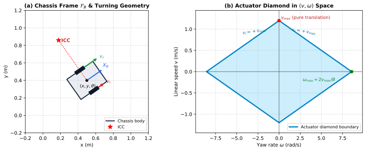
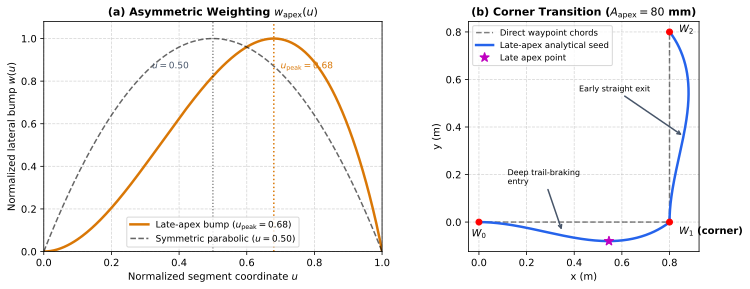
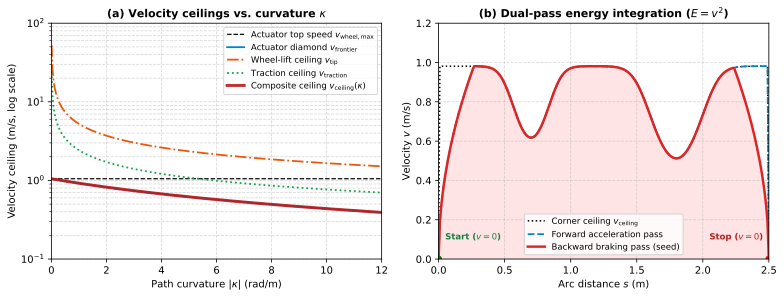
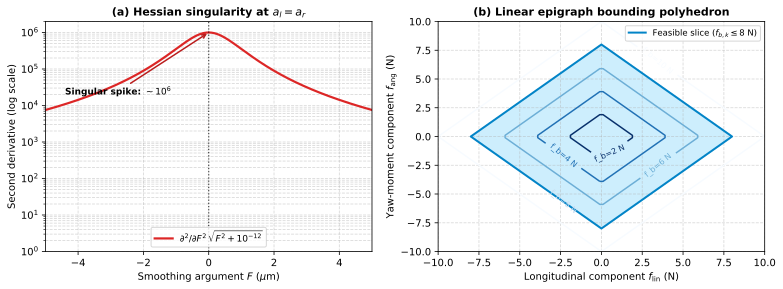
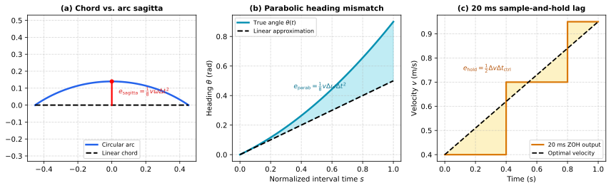
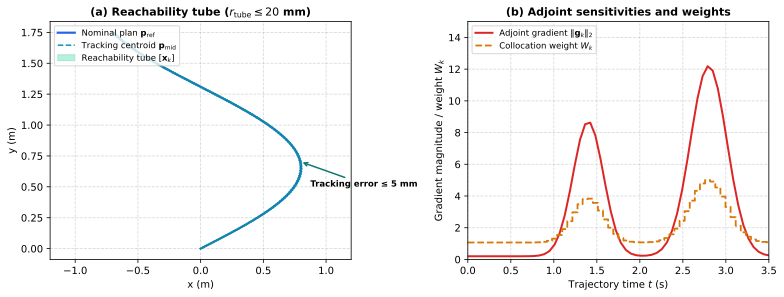

## Abstract {.unnumbered}

Time-optimal trajectory planning for nonholonomic differential-drive mobile robots subject to non-convex actuator polytopes, dynamic wheel load transfer, and bounded physical tracking tolerances remains a fundamental challenge in constrained optimal control. Traditional methods often resort to stochastic genetic algorithms, conservative kinematic Dubins paths, or smooth $L_2$-norm wheel force approximations that put a $10^6$ spike in the Hessian where the two wheel-force shares are equal ($a_l = a_r$), choking the interior-point line search.

This paper documents the engineering framework behind **Project O.V.E.R.B.O.A.R.D** (*Optimal Velocity Envelope Routing with Bounded Output Autodiff Reachability Diagnostics*). The architecture rests on three pillars:
1. **Asymmetric Transition Geometry**: analytical seeding (measured at about 1.3 ms per seed and 2.5 ms for the triad) via tangent bisector geometry and power-law late-apex deformation across a three-candidate homotopy set;
2. **Composite Kinetic Velocity Envelope**: an energy-domain ($E = v^2$) dual-pass horizon combining diamond actuator bounds, dynamic tip-over thresholds, and Coulomb tire traction ceilings;
3. **Discretization-Consistent KKT Collocation**: a 50 ms targeting collocation mesh (a heuristic, not a derived rule) integrated via 4-node Gauss-Legendre quadrature, with four linear epigraph force bounds that remove the Hessian spike.

Candidates are checked by interval reachability. The default is an **open-loop plant propagation** with the controller evaluated outside the tube; the opt-in `tick` propagation embeds one closed-loop tick and needs the mixed-Jacobian inclusion. An optional reverse-mode adjoint polish re-weights the samples nearest the gate in a 20 ms Zero-Order Hold (ZOH) Ramsete rollout. Whether a plan passes is decided per mission by the gates, never by the architecture.

That ordering is deliberate. The objective is not speed but **spread**, with speed taken inside a spread budget; "time-optimal" here means *the fastest plan whose predicted spread at the required poses stays inside the budget*. The reachability tube is that spread, and the gates are where it is allowed to stop growing.

---

::: {.callout-important title="Status of these claims"}
This paper documents the mechanism. The measured record is
[`HEURISTICS_AND_VERIFICATION.md`](HEURISTICS_AND_VERIFICATION.md), the strategies that were retired are in
[`STRATEGY_LEDGER.md`](STRATEGY_LEDGER.md), and the open questions are in
[`RESEARCH_AGENDA.md`](RESEARCH_AGENDA.md). Read this box before quoting a number from here.

- **The seeds are heuristics, not a law.** The tangent bisector, the late-apex deformation and the energy horizon set the basin the solver starts in; nothing constrains the plan to keep the bulge. Measured, the seed axis buys nothing under the current collocation (Q3).
- **The mesh is clamped, not invariant.** 10-18 intervals per segment, and the 50 ms target is met only on short segments - see the mesh section below.
- **The gates are verdicts of the model.** 5 mm tracking and 20 mm envelope against the declared uncertainty box, with the plant-robot match assumed (KI-020). They are not hardware guarantees.
- **The S-curve fails today**: 0.51 cm against the 5 mm tracking gate. The other roadmap missions pass, with `--propagation tick`.
- **Two open levers.** The gradient polish has never been measured (Q16), and the default `plant` propagation bounds an open-loop plant with the controller outside the tube (KI-049); `tick` is the closed-loop model.
- **The verdict is a boolean** against thresholds the operator did not choose (KI-055), and the envelope limit is absolute, so a long path can fail for being long (KI-054); the hierarchy of §Objective is enforced here as a filter, not as a ranking.
:::

---

# Objective: precision from the reference, not the controller

## Two clocks

Planning and execution do not share a clock, and the asymmetry is what makes this a planning problem at all. Offline, on a PC, a solve takes seconds to minutes and may evaluate several candidates against a reachability model. Online, on the hub, one control tick is 20 ms: read the gyroscope and the encoders, evaluate Ramsete, write the wheel commands. The robot cannot re-plan, filter or re-estimate while it drives, and it does no computation between power-on and the first move.

Every method in this paper therefore lives on the offline side of that line. The reference path is the last place precision can be bought, because it is the last place anything is computed.

## Three classes of failure

The loop closes on measured error, so it can correct only what it can measure:

1. **Recoverable disturbance.** Ramsete removes cross-track and heading error against the reference, at a rate set by $k_1$ in @eq-ramsete-closed-loop.
2. **Control failure.** The reference asks for more than the wheels can deliver, and no controller can track it (@eq-actuator-diamond, @eq-traction-envelope).
3. **Measurement failure.** Slip and drift corrupt the odometry the loop corrects against, so it corrects toward a pose that is wrong.

The classes interact, and the interaction is why the gain is not a free parameter: a hard correction is a demand for wheel force, wheel force is what breaks traction, and broken traction destroys the odometry the correction depends on. A path that provokes corrections damages the sensing it needs.

Classes 2 and 3 are fixed at plan time — by where the path turns hard, accelerates hard, or dead-reckons over a long stretch — and no tuning of the controller changes them.

## The hierarchy

Spread first, then time, then residual pose error, because a tight execution with a constant offset can be calibrated out while scatter cannot:

$$\min_{\boldsymbol{\zeta}} \; t_f = \sum_{i=0}^{M-1} S_i \Delta t_i \quad \text{s.t.} \quad \hat{r}_k \le d_{\text{tube}}, \quad \hat{e}_k \le d_{\text{gate}}, \quad \text{and the constraints of the NLP above}$$ {#eq-goal-hierarchy}

where $\hat{r}_k$ is the predicted reachable-set radius at node $k$ and $\hat{e}_k$ the predicted tracking error. Spread enters as a bound rather than as a linear term because a strict lexicographic order on continuous objectives is degenerate — no two plans have equal spread, so the second objective would never be reached.

The current implementation of @eq-goal-hierarchy is the certification gate of the Verification section, in two strengths: the soft $J_{\text{disc}}$ penalty normalises the three discretization mechanisms by $d_{\text{gate}}$ inside the cost (@eq-nlp-objective), and the interval tube is the hard check.

---

# System Dynamics & Physical Formulation

## Differential-Drive Kinematics

Let the pose of a differential-drive robot in the inertial world frame $\mathcal{F}_W$ be denoted by $\mathbf{q}(t) = \begin{bmatrix} x(t) & y(t) & \theta(t) \end{bmatrix}^T \in \mathbb{R}^2 \times \mathbb{S}^1$. The nonholonomic no-slip constraint eliminates lateral chassis motion:

$$\dot{x}(t)\sin\theta(t) - \dot{y}(t)\cos\theta(t) = 0$$ {#eq-nonholonomic}

Let $v(t) \in \mathbb{R}$ denote linear forward velocity, $\omega(t) \in \mathbb{R}$ denote angular yaw velocity, $B \in \mathbb{R}_{>0}$ denote the axle track width, and $r \in \mathbb{R}_{>0}$ denote the nominal wheel radius. 

The forward kinematics mapping individual left and right wheel rim linear velocities $\mathbf{v}_w(t) = \begin{bmatrix} v_l(t) & v_r(t) \end{bmatrix}^T$ to body-frame velocities $\mathbf{V}(t) = \begin{bmatrix} v(t) & \omega(t) \end{bmatrix}^T$, along with its inverse, are defined by:

$$\begin{bmatrix} v(t) \\ \omega(t) \end{bmatrix} = \begin{bmatrix} \frac{1}{2} & \frac{1}{2} \\ -\frac{1}{B} & \frac{1}{B} \end{bmatrix} \begin{bmatrix} v_l(t) \\ v_r(t) \end{bmatrix}, \qquad \begin{bmatrix} v_l(t) \\ v_r(t) \end{bmatrix} = \begin{bmatrix} 1 & -\frac{B}{2} \\ 1 & \frac{B}{2} \end{bmatrix} \begin{bmatrix} v(t) \\ \omega(t) \end{bmatrix}$$ {#eq-kinematics}

{#fig-kinematics-polytope}

## Rigid Body Dynamic Force Decomposition

Let $m$ denote total vehicle mass and $I_z$ denote yaw moment of inertia about the center of mass (CoM). Differentiating wheel velocities gives linear wheel accelerations $a_l(t) = \dot{v}_l(t)$ and $a_r(t) = \dot{v}_r(t)$. Newton-Euler dynamics yield chassis translational and angular accelerations:

$$\dot{v} = \frac{a_l + a_r}{2}, \qquad \dot{\omega} = \frac{a_r - a_l}{B}$$ {#eq-chassis-accel}

The net propulsion force $F_{\text{net}} = m \dot{v}$ and net yaw moment $\tau_z = I_z \dot{\omega}$ generated by ground-contact forces $F_l, F_r$ satisfy:

$$\begin{aligned}
F_l + F_r &= m \left(\frac{a_l + a_r}{2}\right) \\
\frac{B}{2}(F_r - F_l) &= I_z \left(\frac{a_r - a_l}{B}\right) \implies F_r - F_l = \frac{2 I_z (a_r - a_l)}{B^2}
\end{aligned}$$ {#eq-force-balance}

Decoupling @eq-force-balance isolates the longitudinal acceleration force $f_{\text{lin}}$ and yaw moment thrust $f_{\text{ang}}$:

$$f_{\text{lin}}(a_l, a_r) \triangleq \frac{m(a_l + a_r)}{4}, \qquad f_{\text{ang}}(a_l, a_r) \triangleq \frac{I_z(a_r - a_l)}{B^2}$$ {#eq-force-decouple}

$$\begin{cases}
F_l(a_l, a_r) = f_{\text{lin}} - f_{\text{ang}} = \frac{m}{4}(a_l + a_r) - \frac{I_z}{B^2}(a_r - a_l) \\
F_r(a_l, a_r) = f_{\text{lin}} + f_{\text{ang}} = \frac{m}{4}(a_l + a_r) + \frac{I_z}{B^2}(a_r - a_l)
\end{cases}$$ {#eq-wheel-forces}

## Actuator Diamond Polytope

Permanent-magnet DC motors exhibit a linear back-EMF torque-speed curve. Factoring in gear ratio $G$, motor stall torque $\tau_{\text{stall}}$, motor no-load angular velocity $\omega_{\text{noload}}$, and torque headroom factor $\eta_{\text{torque}} \in (0, 1]$, the available tractive force magnitude at wheel speed $v_w$ is governed by:

$$F_{\text{motor}}(v_w) = \frac{\tau_{\text{stall}} G \eta_{\text{torque}}}{r} \left(1 - \frac{G |v_w|}{r \, \omega_{\text{noload}}}\right)$$ {#eq-motor-curve}

Defining stall force $F_{\text{stall}} \triangleq \frac{\tau_{\text{stall}} G \eta_{\text{torque}}}{r}$ and no-load wheel velocity $v_{\text{noload}} \triangleq \frac{r \, \omega_{\text{noload}}}{G}$, the condition simplifies to:

$$|F_{l,r}| \le F_{\text{stall}} \left(1 - \frac{|v_{l,r}|}{v_{\text{noload}}}\right)$$ {#eq-actuator-diamond}

Pillar II uses $v_{\text{wheel,max}}$, the configured wheel-speed limit: $v_{\text{noload}}$ with the configured speed headroom (0.90 by default) applied.

## Dynamic Lateral Load Transfer and Tire Traction

Let $h_{\text{cg}}$ represent CoM height and $g = 9.81\text{ m/s}^2$. Because a two-wheel differential chassis lacks a suspension pitch linkage, longitudinal acceleration does not shift weight laterally. However, lateral centripetal acceleration $a_c = v \omega$ induces significant lateral load transfer across track $B$:

$$\Delta N = \frac{m \, h_{\text{cg}} \, v \, \omega}{B}$$ {#eq-weight-transfer}

$$N_l(v, \omega) = \frac{m g}{2} - \frac{m \, h_{\text{cg}} \, v \, \omega}{B}, \qquad N_r(v, \omega) = \frac{m g}{2} + \frac{m \, h_{\text{cg}} \, v \, \omega}{B}$$ {#eq-normal-forces}

Under Coulomb tire friction with coefficient $\mu$, local wheel-slip and global tractive saturation dictate:

$$|F_l| \le \mu N_l(v, \omega), \qquad |F_r| \le \mu N_r(v, \omega), \qquad |F_l| + |F_r| \le \mu m g$$ {#eq-traction-envelope}

---

# Trajectory Optimization Problem

Everything above describes a physical quantity. This section states the nonlinear program the solver actually receives, because it is not a textbook optimal control problem: **there is no control variable.** The input is reconstructed from consecutive states, so the transcription is state-only.

## Node State and Derived Input

With $M+1$ waypoints $\mathbf{w}_0,\dots,\mathbf{w}_M$ the path has $M$ segments, and segment $i$ (the chord $\mathbf{w}_i \to \mathbf{w}_{i+1}$) is given $S_i$ collocation intervals. Writing $N = 1 + \sum_{i=0}^{M-1} S_i$ for the node count, the state at node $k$ is

$$\mathbf{z}_k = \begin{bmatrix} x_k & y_k & \theta_k & v_{l,k} & v_{r,k} \end{bmatrix}^T \in \mathbb{R}^5, \qquad k = 0,\dots,N-1$$ {#eq-state-vector}

The state carries the **wheel** speeds, not the chassis pair: every force bound is per wheel (@eq-wheel-forces, @eq-motor-curve, @eq-traction-envelope), so $(v,\omega)$ and the wheel accelerations are derived and never optimised:

$$v_k = \frac{v_{l,k}+v_{r,k}}{2}, \qquad \omega_k = \frac{v_{r,k}-v_{l,k}}{B}, \qquad a_{l,k} = \frac{v_{l,k+1}-v_{l,k}}{\Delta t_{\sigma(k)}}, \qquad a_{r,k} = \frac{v_{r,k+1}-v_{r,k}}{\Delta t_{\sigma(k)}}$$ {#eq-derived-input}

where $\sigma(k) \in \{0,\dots,M-1\}$ is the segment that owns interval $k$. The accelerations are the only place an input appears, and they are functions of $\mathbf{z}$ and $\Delta t$.

## Decision Vector

$$\boldsymbol{\zeta} = \left( \Delta t_0,\dots,\Delta t_{M-1}, \; \mathbf{z}_0,\dots,\mathbf{z}_{N-1}, \; f_{b,0},\dots,f_{b,N-2} \right)$$ {#eq-decision-vector}

with $5N$ state entries, $M$ interval times and $N-1$ epigraph slacks. The interval time is **per segment**, not global: the $S_i$ intervals of segment $i$ share one $\Delta t_i$, so $t$ is piecewise linear and the total duration is $\sum_i S_i \Delta t_i$. Because $\Delta t$ is a decision variable, the defects and the accelerations are nonlinear in it.

The problem is, for the cost $J$ of @eq-nlp-objective:

- **defects** @eq-gl-pos-defect and @eq-gl-heading-defect, on every interval $k = 0,\dots,N-2$;
- **waypoint pins** $x = x_i$, $y = y_i$, and $\theta = \theta_i$ where the waypoint pins a heading, at node $n_i = \sum_{j<i} S_j$;
- **rest** $v_l = v_r = 0$ at node $0$, at node $N-1$, and at every stop waypoint;
- **acceleration continuity** at a waypoint the robot drives through, where the two adjacent segments meet: $(v_{l,k}-v_{l,k-1})\Delta t_i = (v_{l,k+1}-v_{l,k})\Delta t_{i-1}$ and the same for $v_r$, so the wheel force is continuous through the node;
- **force epigraphs** @eq-epigraph-linear with the motor and normal-force ceilings @eq-epigraph-motor and @eq-epigraph-normal;
- **boxes** $0.001 \le \Delta t_i \le 1$, $|v_{l,k}|, |v_{r,k}| \le 0.99 \, v_{\text{wheel,max}}$, and the $[-20, 20]$ m and $[-100, 100]$ rad guards on position and heading.

## Remark: what this transcription is and is not

It is a **state-only direct transcription with the input eliminated**: no $\mathbf{u}$ vector, no shooting roll-out, and no separate continuity unknown for the accelerations. That is why the force-continuity rule above is written on wheel-speed differences rather than on a control, and why the solver's acceleration limits are enforced through those differences and $\Delta t$. It is **not** an implicit Gauss-Legendre collocation scheme in the Runge-Kutta sense - the defects are quadrature evaluations of the position integral over a velocity that is linear and a heading that is quadratic in $s$ (@eq-continuous-interpolants) - and the "$\mathcal{O}(\Delta t^7)$" used elsewhere in this document is the polynomial exactness of the four-node rule, not a measured convergence order.

---

# Pillar I: Asymmetric Transition Geometry & Analytical Seeding

Rather than initializing the non-convex optimal control problem from straight chords ($v=0$) or evolutionary random walks, Pillar I deterministically generates an analytical initial guess in a few milliseconds (measured: 1.29 ms for the sprint seed, 2.51 ms for the triad). These are **design heuristics** that reproduced well on the example missions, not theorems: nothing proves the seed is Pontryagin-optimal.

## Smooth Tangent Bisector Heading Synthesis

Given ordered waypoints $\mathcal{W} = \{ \mathbf{w}_i = (x_i, y_i, \theta_i) \}_{i=0}^M$ where unconstrained headings are indicated by $\theta_i = \text{None}$:
1. Compute chord vectors $\Delta \mathbf{p}_i = \begin{bmatrix} x_{i+1} - x_i & y_{i+1} - y_i \end{bmatrix}^T$ and chord angles $\phi_i = \text{atan2}(\Delta y_i, \Delta x_i)$ for $i=0, \dots, M-1$.
2. For intermediate waypoints $i \in \{1, \dots, M-1\}$ where $\theta_i = \text{None}$, evaluate the continuous tangent bisector:

$$\theta_i = \phi_{i-1} + \frac{1}{2}\text{wrap}(\phi_i - \phi_{i-1})$$ {#eq-bisector}

where $\text{wrap}(\alpha) \triangleq (\alpha + \pi) \pmod{2\pi} - \pi$.
3. Fixed terminal waypoints are set to $\theta_0 = \phi_0$ and $\theta_M = \phi_{M-1}$ unless pinned by user boundary conditions.

## Late-Apex Dynamic Law

The design heuristic, taken from race-vehicle lines and confirmed on the example missions, is that differential-drive robots should execute asymmetric late-apex lines: trail-braking deep into corner entries to sustain approach momentum, rotating rapidly past the midpoint, and accelerating out earlier along flatter paths.

Segment $i$ with chord length $L_i = \|\Delta \mathbf{p}_i\|$ and chord unit normal $\mathbf{n}_i = \begin{bmatrix} -\Delta y_i / L_i & \Delta x_i / L_i \end{bmatrix}^T$ is parameterized by normalized arc coordinate $u \in [0, 1]$:

$$\mathbf{p}_i(u) = \mathbf{w}_i + u \, \Delta \mathbf{p}_i + A_{\text{apex}, i} \cdot w_{\text{apex}}(u) \, \mathbf{n}_i$$ {#eq-late-apex}

The asymmetric power-law bump function $w_{\text{apex}}(u)$ peaks at $u_{\text{peak}} \in [0.65, 0.70]$:

$$w_{\text{apex}}(u) = \begin{cases} 
\frac{u^a (1-u)^b}{u_{\text{peak}}^a (1 - u_{\text{peak}})^b}, & u \in (0, 1) \\
0, & \text{otherwise}
\end{cases}, \qquad b = a \left(\frac{1 - u_{\text{peak}}}{u_{\text{peak}}}\right), \quad a = 2.0$$ {#eq-bump-func}

The apex deformation amplitude $A_{\text{apex}, i}$ scales with corner angle $\Delta \phi_i = \text{wrap}(\phi_{i+1} - \phi_i)$:

$$A_{\text{apex}, i} = -\text{sgn}(\Delta \phi_i) \min(0.20 L_i, \, 0.08) \cdot K_{\text{style}} \cdot \sin\left(\min\left(|\Delta \phi_i|, \, \frac{\pi}{2}\right)\right)$$ {#eq-apex-amplitude}

with $K_{\text{style}} = 1.0$ for the sprint seed, $0.9$ for the sweeper and $1.25$ for the exploratory seed.

The deformation is applied only where the segment is longer than 0.05 m, the corner turns by more than 0.15 rad, and the segment does not end at a stop; elsewhere $A_{\text{apex}, i} = 0$. Path points $\mathbf{p}(s) = \begin{bmatrix} x(s) & y(s) \end{bmatrix}^T$ yield tangent headings $\theta(s) = \text{atan2}(y'(s), x'(s))$ and regularized curvature $\kappa(s) \approx \frac{\Delta \theta_k}{\Delta s_k}$.

{#fig-late-apex}

---

# Pillar II: Composite Kinetic Velocity Envelope

The maximum allowable linear velocity $v(s)$ at path curvature $\kappa(s)$ is bounded by actuator saturation, vehicle rollover, and tire slip.

## Composite Ceiling Formulation

1. **Actuator Diamond Ceiling**: Turning at yaw rate $\omega = v \kappa$ forces the outer wheel to speed $v_{\text{outer}} = v(1 + \frac{B}{2}|\kappa|) \le v_{\text{wheel,max}}$:

$$v_{\text{frontier}}(\kappa) = \frac{v_{\text{wheel,max}}}{1 + \frac{1}{2} B |\kappa|}$$ {#eq-v-frontier}

2. **Dynamic Load Transfer & Wheel Lift Threshold**: Setting inner wheel normal force $N_{\text{inner}} = 0$ in @eq-normal-forces reveals the tipping boundary:

$$\frac{m g}{2} - \frac{m \, h_{\text{cg}} \, v^2 |\kappa|}{B} = 0 \implies v_{\text{tip}}(\kappa) = \sqrt{\frac{g B}{2 \, h_{\text{cg}} \max(|\kappa|, \epsilon)}}$$ {#eq-v-tip}

3. **Coulomb Adhesion Limit**: Tractive centripetal acceleration cannot exceed maximum static friction $a_c \le \mu g$:

$$v^2 |\kappa| \le \mu g \implies v_{\text{traction}}(\kappa) = \sqrt{\frac{\mu g}{\max(|\kappa|, \epsilon)}}$$ {#eq-v-traction}

The composite cornering ceiling $v_{\text{ceiling}}(\kappa)$ is the lower envelope of all four bounds:

$$v_{\text{ceiling}}(\kappa) = \min \Big( v_{\text{wheel,max}}, \, v_{\text{frontier}}(\kappa), \, v_{\text{tip}}(\kappa), \, v_{\text{traction}}(\kappa) \Big)$$ {#eq-composite-ceiling}

At waypoints that are neither a stop nor an endpoint, the seed raises the ceiling to at least $0.60$–$0.72 \, v_{\text{wheel,max}}$ (style dependent), capped by the actuator ceiling, so an unpinned waypoint does not force the robot to a crawl. Stop and endpoint samples are set to zero.

## Energy-Domain ($E = v^2$) Dual-Pass Horizons

Let $a_{\max} \in \mathbb{R}_{>0}$ represent longitudinal acceleration limits derived from motor stall torque and longitudinal traction:

$$a_{\max} = \min \left( \frac{2 \tau_{\text{stall}} G}{r \, m} \cdot 0.45, \, \mu g \cdot 0.65, \, 2.8 \right) \cdot K_{\text{accel\_scale}}$$ {#eq-a-max}

Operating in the kinetic energy domain $E(s) \triangleq v(s)^2$ transforms acceleration constraints $\frac{d(v^2)}{ds} = 2 a$ into linear energy steps across arc distance $\Delta s_k = \|\mathbf{p}_{k+1} - \mathbf{p}_k\|$:

$$\Delta E_k = 2 a_{\max} \Delta s_k$$ {#eq-delta-energy}

{#fig-velocity-ceiling-energy}

1. **Ceiling Initialization**: $E_k^{(0)} = v_{\text{ceiling}}(\kappa_k)^2$ for $k=0, \dots, N-1$. At stop indices $k \in \mathcal{K}_{\text{stop}}$, enforce $E_k^{(0)} = 0$.
2. **Forward Acceleration Pass** ($k = 0 \to N-2$):

$$E_{k+1}^{(1)} = \min \left( E_{k+1}^{(0)}, \, E_k^{(1)} + \Delta E_k \right)$$ {#eq-forward-pass}

3. **Backward Braking Pass** ($k = N-2 \to 0$):

$$E_k^{(2)} = \min \left( E_k^{(1)}, \, E_{k+1}^{(2)} + \Delta E_k \right)$$ {#eq-backward-pass}

The seed wheel velocities are recovered via $v_k = \sqrt{E_k^{(2)}}$ (with a non-stop sample below 0.08 m/s raised to 0.08 m/s) and inverse kinematics:

$$v_{l,k} = v_k \left(1 - \frac{B}{2}\kappa_k\right), \qquad v_{r,k} = v_k \left(1 + \frac{B}{2}\kappa_k\right)$$ {#eq-seed-ik}

---

# Pillar III: Discretization-Consistent Collocation Mesh & KKT NLP

## 50 ms Targeting Mesh Allocation

Tracking error in sampled-data differential-drive systems is largely driven by chordal discretization lag. Uniform sample allocation starves short, sharp turns. The mesh aims each segment at about 50 ms of nominal transit. It is a **chosen heuristic, not a derived rule**; the gates decide whether a plan passes:

$$T_{\text{est}, i} = \max\left(0.1, \, \frac{L_i}{\max(0.1, \, 0.65 \, v_{\text{wheel,max}})}\right), \qquad S_i = \text{clamp}\left( \text{round}\left( \frac{T_{\text{est}, i}}{0.050\text{ s}} \right), \, 10, \, 18 \right)$$ {#eq-mesh-sizing}

where $S_i$ is the number of collocation intervals allocated to segment $i$.

**The cap binds, and that is measured to be benign.** At the default robot ($v_{\text{wheel,max}} = 0.477$ m/s, so $0.65\,v_{\text{wheel,max}} = 0.310$ m/s) the cap is reached by any segment longer than 0.27 m. `example_straight`'s single 1 m segment asks for 64 intervals and receives 18 (126 ms of the shipped 2.27 s plan); on `example_s_curve` each 0.583 m segment asks for 38 and receives 18, so the 3.67 s plan spends about 102 ms per interval. The 50 ms name is therefore met only on the short-segment missions (`example_complex_mission`, `example_mission_first4`), where the cap does not bind.

Density is nonetheless not the lever it looks like. The tracking error is U-shaped in the sampling density, with its floor at 4-5 controller ticks per interval ([RQ-A F6](research/RQ-A_tracking_error.md)): the shipped mesh's 102 ms is 5.1 ticks, and on that measurement's reference 86 ms and 118 ms tracked 0.245 cm and 0.489 cm, so the cap sits in the flat bottom of the curve and does not explain the 0.51 cm the S-curve shows today. Refining to 44 ms per interval (40 per segment) tracked 0.271 cm - inside the gate, and no better than 86 ms for five times the solve. What that sweep does point at, and what does not ship, is an **interval-average reference** (0.098 cm against 0.271 cm on the same plan).

## 4-Node Gauss-Legendre Quadrature Defect Constraints

Standard trapezoidal collocation exhibits $\mathcal{O}(\Delta t^3)$ truncation error, treating circular arcs as linear chords. A 4-node Gauss-Legendre rule is exact for polynomial integrands up to degree $2n-1 = 7$; for the non-polynomial integrand $v(s)\cos\theta(s)$ the local quadrature error scales as $\mathcal{O}(\Delta t^9)$ and the collocation solution is superconvergent at the nodes. The repository's "$\mathcal{O}(\Delta t^7)$" is shorthand for that polynomial exactness, not a measured convergence rate. We apply **4-point Gauss-Legendre quadrature** over step interval $[t_k, t_{k+1}]$ with roots $\xi_j \in [-1, 1]$ and weights $w_{\xi, j}$:

$$\xi \in \begin{Bmatrix} -0.8611363116 \\ -0.3399810436 \\ +0.3399810436 \\ +0.8611363116 \end{Bmatrix}, \qquad w_\xi \in \begin{Bmatrix} 0.3478548451 \\ 0.6521451549 \\ 0.6521451549 \\ 0.3478548451 \end{Bmatrix}$$ {#eq-gauss-legendre-nodes}

Defining $s(\xi_j) = \frac{1}{2}\Delta t_k (1 + \xi_j)$ and $W(\xi_j) = \frac{1}{2}\Delta t_k \, w_{\xi, j}$, linear velocity and yaw angle evolve continuously within interval $k$:

$$v(s) = v_k + (v_{k+1} - v_k)\frac{s}{\Delta t_k}, \qquad \theta(s) = \theta_k + \omega_k s + \frac{\omega_{k+1} - \omega_k}{2 \Delta t_k} s^2$$ {#eq-continuous-interpolants}

The collocation continuity defect constraints are:

$$\mathbf{p}_{k+1} - \mathbf{p}_k - \sum_{j=1}^4 W(\xi_j) \, v(s(\xi_j)) \begin{bmatrix} \cos(\theta(s(\xi_j))) \\ \sin(\theta(s(\xi_j))) \end{bmatrix} = \mathbf{0}$$ {#eq-gl-pos-defect}

$$\theta_{k+1} - \theta_k - \frac{1}{2}(\omega_k + \omega_{k+1})\Delta t_k = 0$$ {#eq-gl-heading-defect}

## Linear Epigraph Formulation of Wheel Force Bounds

::: {.callout-note}
### Design note: Eliminating the Hessian Singularity via Linear Epigraphs
Standard smooth $L_2$ wheel force regularizations $|F| \approx \sqrt{F^2 + \epsilon}$ introduce singular Hessian curvature spikes:
$$\frac{\partial^2}{\partial F^2} \sqrt{F^2 + \epsilon} = \frac{\epsilon}{(F^2 + \epsilon)^{3/2}} \xrightarrow{F \to 0, \, \epsilon = 10^{-12}} 10^6$$
When left and right accelerations are equal ($a_l = a_r$), this puts a $10^6$ entry in the Hessian (a singular curvature direction for the barrier line search) and is what stalls the solver on straights.
:::

We eliminate this singularity by introducing an explicit epigraph bound variable $f_{b,k} \ge \max(|F_{l,k}|, |F_{r,k}|)$. Substituting the force decomposition from @eq-force-decouple yields four linear inequality constraints:

$$\begin{aligned}
f_{b,k} - f_{\text{lin}}(a_{l,k}, a_{r,k}) - f_{\text{ang}}(a_{l,k}, a_{r,k}) &\ge 0 \\
f_{b,k} - f_{\text{lin}}(a_{l,k}, a_{r,k}) + f_{\text{ang}}(a_{l,k}, a_{r,k}) &\ge 0 \\
f_{b,k} + f_{\text{lin}}(a_{l,k}, a_{r,k}) - f_{\text{ang}}(a_{l,k}, a_{r,k}) &\ge 0 \\
f_{b,k} + f_{\text{lin}}(a_{l,k}, a_{r,k}) + f_{\text{ang}}(a_{l,k}, a_{r,k}) &\ge 0
\end{aligned}$$ {#eq-epigraph-linear}

The epigraph slack variable $f_{b,k}$ is bounded at both interval endpoints by motor and dynamic traction envelopes:

$$\begin{aligned} f_{b,k} &\le F_{\text{stall}} \left(1 - \frac{v_w}{v_{\text{noload}}}\right), \\ f_{b,k} &\le F_{\text{stall}} \left(1 + \frac{v_w}{v_{\text{noload}}}\right), \end{aligned} \qquad \forall v_w \in \{v_{l,k}, v_{l,k+1}, v_{r,k}, v_{r,k+1}\}$$ {#eq-epigraph-motor}

$$f_{b,k} \le \mu \, N_l(v, \omega), \qquad f_{b,k} \le \mu \, N_r(v, \omega)$$ {#eq-epigraph-normal}

The two rows are the sign split of $|v_w|$: each is linear in the decision variables with a constant Jacobian, so the absolute value never appears in the expression tree. A single inequality with an absolute value would put a kink back into the constraint.

{#fig-hessian-epigraph} The unified planner selects this epigraph form for all three candidates, bounds the interval at both endpoints, and writes the motor bound in both directions. The library's plain branch keeps the smooth $\sqrt{\cdot}$ bound for callers that do not ask for it.

## Discretization Tracking-Gate Objective

To explicitly account for the physical 5 mm tracking gate during optimization, the objective function penalizes the three primary discrete error mechanisms:

$$e_{\text{sagitta}, k} = \frac{\frac{1}{8} v_{\text{mid}, k} \, \omega_{\text{mid}, k} \, \Delta t_k^2}{d_{\text{gate}}}, \qquad e_{\text{parabolic}, k} = \frac{\frac{1}{8} v_{\text{mid}, k} (\omega_{k+1} - \omega_k)\Delta t_k^2}{d_{\text{gate}}}$$ {#eq-disc-err-1}

$$e_{\text{hold}, k} = \frac{\frac{1}{2}(v_{k+1} - v_k)\Delta t_{\text{ctrl}}}{d_{\text{gate}}}$$ {#eq-disc-err-2}

where $d_{\text{gate}} = 0.005\text{ m}$ and $\Delta t_{\text{ctrl}} = 0.020\text{ s}$. The complete discrete optimal control problem is:

$$\min_{\Delta \mathbf{t}, \mathbf{X}, \mathbf{f}_b} \quad J = \sum_{i=0}^{M-1} S_i \Delta t_i + w_{\text{acc}} J_{\text{jerk}} + w_{\text{disc}} \sum_{k=0}^{N-2} w_k \left( e_{\text{sagitta}, k}^2 + e_{\text{parabolic}, k}^2 + \frac{1}{4}e_{\text{hold}, k}^2 \right) + w_{\text{force}} J_{\text{force}}$$ {#eq-nlp-objective}

The constraints are the position and heading defects @eq-gl-pos-defect and @eq-gl-heading-defect, the four linear epigraph inequalities @eq-epigraph-linear, and the motor and normal-force bounds @eq-epigraph-motor and @eq-epigraph-normal.

Here $w_{\text{disc}}$ is not a free weight: the planner uses $\max(10\,w_{\text{acc}}, 0.02)$, so all three candidates share the same discretization weight and differ only in the jerk weight.

{#fig-discretization-mechanisms}

---

# Verification & Differentiable Sensitivity Polish

## Interval Reachability Mechanics

Given a parametric uncertainty box $\mathbf{w} \in [\underline{\mathbf{w}}, \overline{\mathbf{w}}] \subset \mathbb{R}^7$ bounding tire friction $\mu$, torque headroom $\eta_{\text{torque}}$, gear backlash, track width $B$, wheel radius $r$, inertia $I_z$, and motor gain, the system is verified as a continuous differential inclusion:

$$\dot{\mathbf{x}}(t) \in [f](\mathbf{x}(t), \mathbf{u}(t), [\mathbf{w}])$$ {#eq-diff-inclusion}

Tracking uses an unrolled **20 ms Sample-and-Hold Ramsete Controller** (the firmware's, gains $b = 2.0$, $\zeta = 0.7$):

$$\begin{bmatrix} v_{\text{cmd}} \\ \omega_{\text{cmd}} \end{bmatrix} = \begin{bmatrix} v_{\text{ref}}\cos e_\theta + k_1 e_x \\ \omega_{\text{ref}} + b \, v_{\text{ref}} \, \text{sinc}(e_\theta) \, e_y + k_1 e_\theta \end{bmatrix}, \qquad k_1 = 2 \zeta \sqrt{\omega_{\text{ref}}^2 + b \, v_{\text{ref}}^2}$$ {#eq-ramsete-closed-loop}

The JAX rollout evaluates $\text{sinc}(e_\theta)$ with a 7-term Chebyshev polynomial (maximum absolute error about $2.5\times10^{-9}$ on $[-\pi, \pi]$), because Immrax's natural inclusion cannot trace `jnp.sinc`, `abs` or `where`; the firmware uses $\sin e_\theta / e_\theta$ with an explicit branch at zero.

The shipped validation default is the **open-loop plant propagation** (`PROPAGATION = "plant"`, natural interval inclusion): the controller is evaluated at the tube midpoint and the interval arithmetic never sees the feedback. `--propagation tick` embeds one closed-loop tick and uses the mixed-Jacobian inclusion, at 2–3x (`jac`) to 7–10x (`mjac`) the validation time. An envelope is never read without its propagation and inclusion.

When a digital twin supplies the plant, `DigitalTwinOpenLoop` carries its wheel states as mean speed and difference, $v_{\text{mean}}$ and $v_{\text{diff}} = v_r - v_l$, not as $v_l, v_r$. An interval box treats its coordinates as independent, so on a straight the naive subtraction $\omega = (v_r - v_l)/B$ reports a phantom yaw rate of width $\pm(\overline{g} - \underline{g})|v_{\text{cmd}}|/B$ even though the true rate is zero; that phantom integrates into heading and then lateral drift and drives the tube past the gate. Taking the difference of the *commands* before the uncertain gain multiplies them makes $v_{\text{diff}}$ a point on a straight, so the enclosure stays tight. The change of variables is a linear bijection, so the propagated set is still a valid bound of the same reachable set.

A candidate is certified when the interval bounds satisfy

$$\max_k \|\mathbf{p}_{\text{mid}, k} - \mathbf{p}_{\text{ref}, k}\|_2 \le 0.005\text{ m} \quad \text{and} \quad \max_k \text{radius}([\mathbf{x}_k]) \le 0.020\text{ m}$$ {#eq-certification-gates}

and no motor-force, wheel-slip, wheel-speed or divergence violation is reported. The tracking gate is fixed at 5 mm; the envelope limit defaults to 20 mm and can be set per run (1–50 mm) or per waypoint (`error_threshold`). Certification is a verdict of the model, not a hardware guarantee: `CLAIMS.md` records the plant-robot match as assumed, and the S-curve example fails the tracking gate today.

### The gate as the precision objective

@eq-certification-gates is usually read as a filter applied after the solve. Under @eq-goal-hierarchy it is the objective: the tube radius is the spread the model predicts, the tracking bound is the residual pose error, and the gate value is where spread is no longer allowed to grow. What the solver minimises is time, inside that budget. Today the hierarchy is enforced as a verdict rather than as a ranking, so the result is boolean against fixed thresholds (KI-055) and a long path can fail for being long rather than for being risky (KI-054); ranking candidates by predicted spread is the open version of the same statement.

## Reverse-Mode Adjoint Sensitivity Polish

The polish is off by default. The planner's `plan()` runs it only when the champion is near the gate ($e_{\text{track}} > 0.90 \cdot d_{\text{gate}}$); the CLI's opt-in `--polish` runs it on every solved candidate. It uses reverse-mode automatic differentiation in JAX to compute the gradient of the boundary violation loss $\mathcal{L}$:

$$\mathcal{L}(\mathbf{X}, \Delta \mathbf{t}) = 10^6 \sum_{k=0}^{N-2} \max\Big(0, \, e_{\text{track}, k} - (d_{\text{gate}} - \delta)\Big)^2 + 10^5 \sum_{k=0}^{N-2} \max\Big(0, \, r_{\text{tube}, k} - (d_{\text{tube}} - \delta)\Big)^2$$ {#eq-autodiff-loss}

with $\delta = 0.4$ mm for tracking and $\delta = 1.0$ mm for the tube.

$$\mathbf{g}_k = \nabla_{\mathbf{x}_k} \mathcal{L} \in \mathbb{R}^5$$ {#eq-autodiff-grad}

Sensitivity gradients are directly mapped into sample weights $W_k$ for a targeted warm-started NLP polish:

$$W_k = \text{clip} \left( 1.0 + 4.0 \left(\frac{\|\mathbf{g}_k\|_2}{\max_j \|\mathbf{g}_j\|_2}\right) + 6.0 \left(\frac{e_{\text{track}, k}}{0.7 \, d_{\text{gate}}} - 0.5\right)_+^2, \, 1.0, \, 200.0 \right)$$ {#eq-weights-update}

{#fig-reachability-tube}

---

# Architectural Flowchart

The end-to-end trajectory generation, optimization, and verification pipeline is depicted below. Stages 1–4 are offline; stage 5 is everything that runs on the robot.

```{mermaid}
%%| label: fig-pipeline
%%| fig-cap: "End-to-end engineering pipeline of Project O.V.E.R.B.O.A.R.D."
flowchart TD
    classDef stageStyle fill:#f8fafc,stroke:#64748b,stroke-width:1.5px,font-weight:bold;
    classDef compStyle fill:#eff6ff,stroke:#2563eb,stroke-width:1.8px,color:#1e3a8a;
    classDef passStyle fill:#ecfdf5,stroke:#059669,stroke-width:2px,color:#064e3b;
    classDef failStyle fill:#fef2f2,stroke:#dc2626,stroke-width:1.8px,color:#7f1d1d;
    classDef gradStyle fill:#fefce8,stroke:#ca8a04,stroke-width:1.8px,color:#713f12;

    subgraph S1["Stage 1: Waypoints & Mesh Allocation"]
        W["Waypoints W = (x_i, y_i, θ_i)"] --> TB["Tangent Bisector Heading Synthesis"]
        TB --> IM["50 ms Targeting Mesh Sizing"]
    end
    class S1 stageStyle;

    subgraph S2["Stage 2: Pillars I & II Analytical Seeding"]
        IM --> LA["Late-Apex Asymmetric Deformation"]
        LA --> CC["Composite Kinetic Velocity Ceiling"]
        CC --> EPass["Energy-Domain Dual-Pass (E = v²)"]
        EPass --> Triad["Candidate Set<br/>(Sprint / Sweeper / Exploratory)"]
    end
    class S2 stageStyle;

    subgraph S3["Stage 3: Pillar III KKT Collocation Solve"]
        Triad --> Opti["CasADi / IPOPT Optimizer"]
        Opti --> GL["4-Node Gauss-Legendre Quadrature Defect Constraints"]
        Opti --> Epi["Dual Half-Space Linear Epigraph Force Bounds"]
        Opti --> Disc["Discretization Tracking-Gate Objective"]
    end
    class S3 stageStyle;

    subgraph S4["Stage 4: Reachability Verification & Optional Polish"]
        GL & Epi & Disc --> Scan["Compiled JAX lax.scan (Ramsete over Uncertain Plant)"]
        Scan --> Check{"Tracking ≤ 5 mm<br/>Tube ≤ 20 mm<br/>No force / slip / speed / divergence?"}
        Check -- "Passed" --> Cert["Selected Passing Candidate"]
        Check -- "Optional polish (near gate, or --polish)" --> Grad["Reverse-Mode Autodiff Adjoint Sensitivity"]
        Grad --> Polish["Warm-Started Weight Re-solve"]
        Polish --> Opti
        Check -- "Violated" --> Fail["Rejected / Best-Effort Fallback"]
    end
    class S4 stageStyle;

    subgraph S5["Stage 5: On the robot - 20 ms Ramsete loop (no re-planning)"]
        Cert --> FW["Firmware: reference interpolation, odometry, drive()"]
        FW --> Run["Run: tracking only - no estimation, no re-plan"]
    end
    class S5 stageStyle;

    class W,TB,IM,LA,CC,EPass,Triad,Opti,GL,Epi,Disc,Scan,FW,Run compStyle;
    class Cert passStyle;
    class Fail failStyle;
    class Grad,Polish gradStyle;
```

---

# Design Comparison

To highlight the computational characteristics of this formulation, @tbl-benchmark compares Project O.V.E.R.B.O.A.R.D against standard trajectory generation techniques.

| Design Dimension | Standard Dubins / Clothoid | Trapezoidal Collocation | Project O.V.E.R.B.O.A.R.D |
| :--- | :--- | :--- | :--- |
| **Actuator Model** | Scalar velocity ceiling | Decoupled box limits ($|a_l|, |a_r| \le a_{\max}$) | Polytope Diamond + Linear Epigraph |
| **Normal Force Coupling** | Ignored (static assumption) | Ignored ($\mu m g / 2$) | Dynamic lateral load transfer $N_{l,r}(v, \omega)$ |
| **Collocation Scheme** | Analytical / Spline fit | Trapezoidal rule ($\mathcal{O}(\Delta t^3)$ truncation) | 4-node Gauss-Legendre (degree-7 exact; convergence order not measured) |
| **Force-bound smoothness** | N/A | $\sqrt{F^2+\epsilon}$ puts a $10^6$ Hessian entry at $F=0$ | Four linear inequalities, zero second derivative (no condition-number study) |
| **Mesh Density** | Uniform spatial division | Uniform sample counts | 50 ms targeting mesh (heuristic) |
| **Seeding Mechanism** | Straight chords ($v=0$) | Heuristic lookahead | Analytical seed set (~1.3 ms per seed, 2.5 ms for three) |
| **Precision** | Not modelled | Post-hoc forward integration | Interval tube from the uncertainty box; the bound the plan is optimised inside |
| **Safety Certification** | None | Post-hoc forward integration (CPU RK4) | JAX interval reachability: open-loop plant by default, opt-in closed-loop tick (mixed-Jacobian) |

: Comparative benchmark of trajectory generation frameworks. {#tbl-benchmark}

---

# Conclusion

Project O.V.E.R.B.O.A.R.D implements a deterministic, time-optimal trajectory planning and tracking pipeline for differential-drive mobile robots.

By combining **Asymmetric Late-Apex Transition Geometry**, **Composite Kinetic Velocity Envelopes**, and **Discretization-Consistent Linear Epigraph Collocation**, the system avoids the force-bound Hessian spike and removes stochastic evolutionary search from the solve path.

The second half of the claim is operability, and it is a claim rather than a nicety: a method that cannot be run on someone else's robot is not a result. The pipeline is therefore three one-command stages — calibrate the robot and its uncertainty ranges, generate and gate a path, deploy the code the gate approved — each of which names the step to fix when it fails, and none of which can let an unvalidated file look approved.

The reachability engine and optional adjoint polish check the plan against dynamic motor curves, wheel-lift tipping limits and Coulomb friction boundaries **in the model**. Whether a plan passes is a per-mission gate verdict: the tracking gate is 5 mm in the model, the plant-robot match is assumed, and the S-curve example fails today.

---

### Instructions for Rendering the Quarto Document {.unnumbered}

To render the document to **HTML** (with interactive code tools and MathJax equations):
```bash
quarto render docs/ControlsDoc.qmd --to html
```

To render the document to **PDF** (via LaTeX / XeLaTeX):
```bash
quarto render docs/ControlsDoc.qmd --to pdf
```

*(Note: For PDF output with Mermaid diagrams, ensure the `rsvg-convert` or `chromium` backend is available in your Quarto installation).*