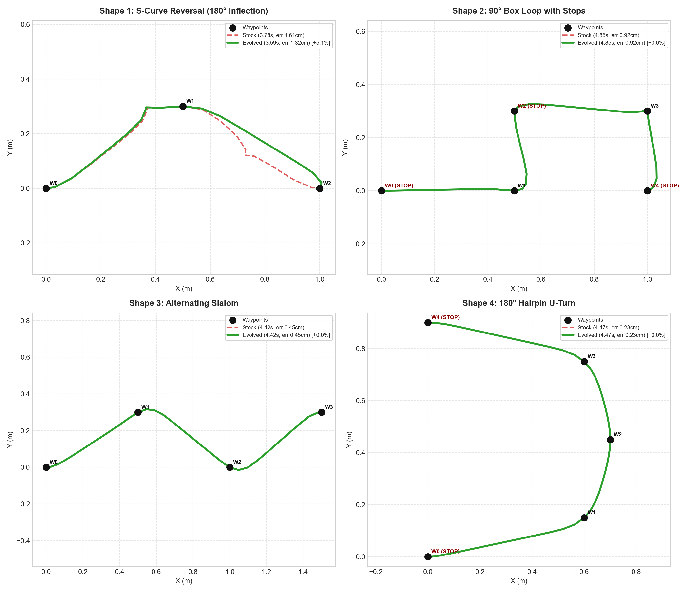
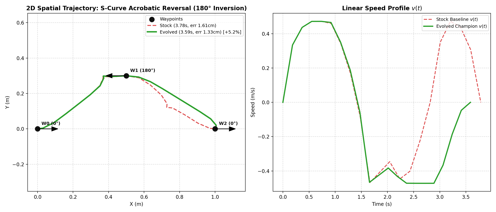
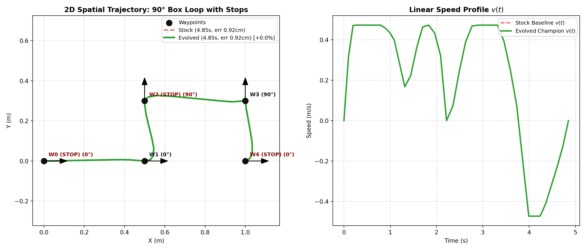
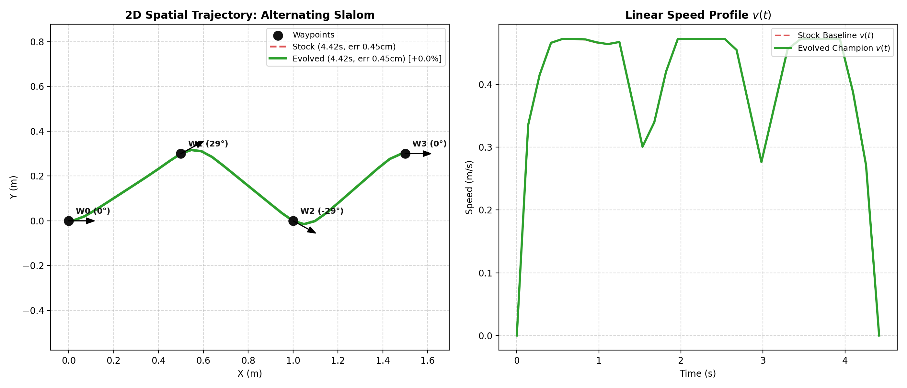
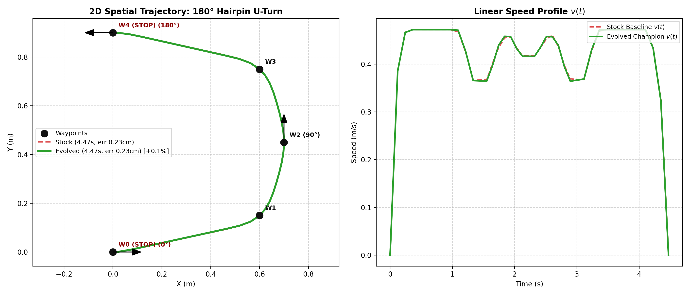
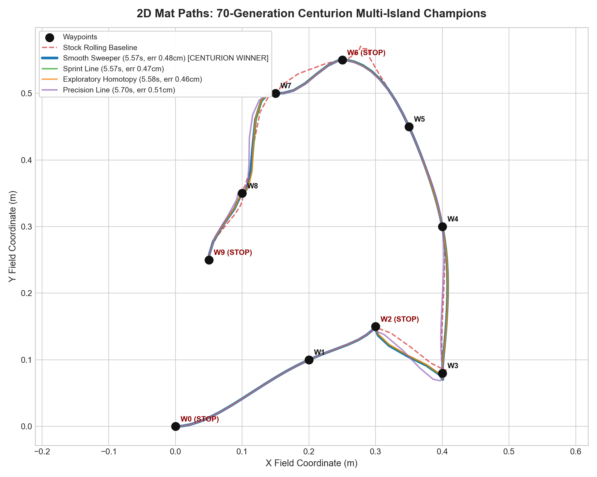
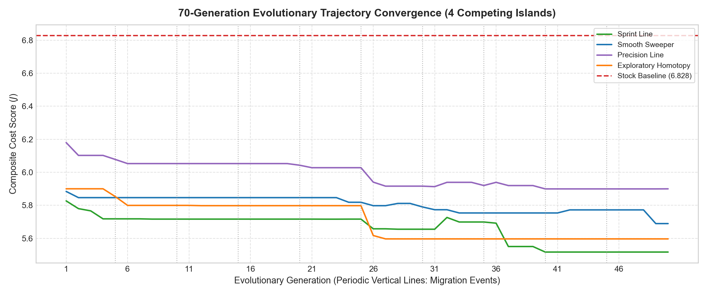
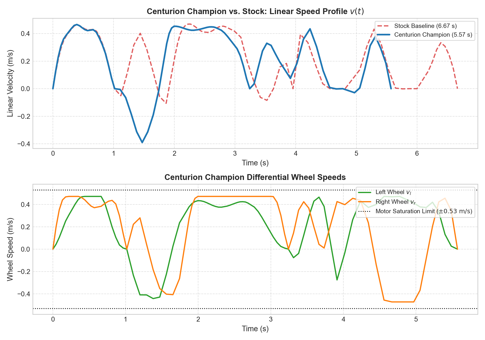
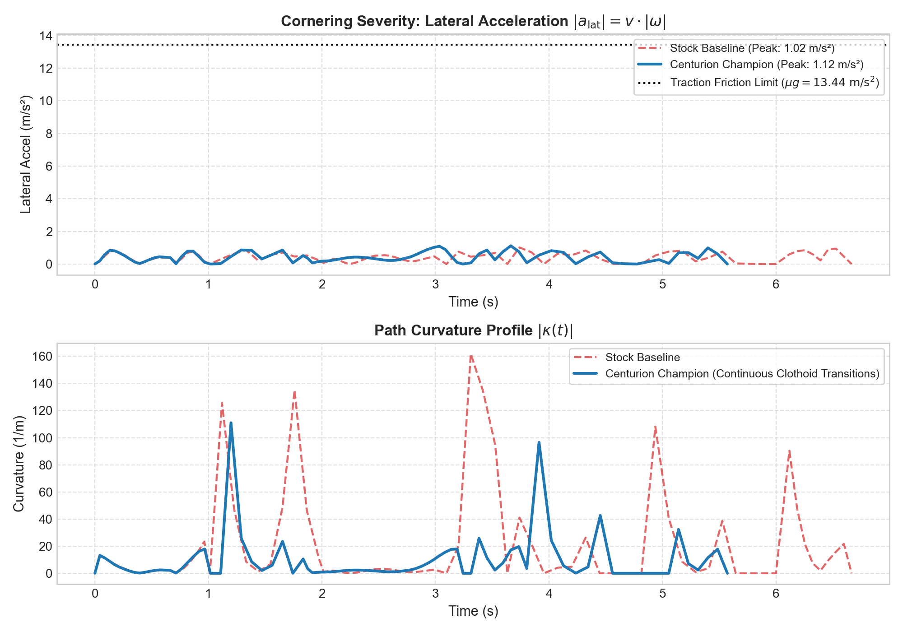

# Master Visual Gallery: Optimal Control & Evolutionary Discovery

> **Research record (2026-10).** This is the exhibition of an earlier phase of the project. Every
> figure here was produced by the evolutionary search, which is archived under
> (git tag `archive/legacy-2026-10`) and is not importable from the current tree. The plots
> cannot be regenerated from the working copy; check out the tag `archive/research-2026-10` to
> re-run their producers. The numbers in the captions are the measurements from that campaign, not
> current benchmark results - `benchmark.py` and `docs/HEURISTICS_AND_VERIFICATION.md` hold those.
> The analytical heuristics these plots illustrate are still what the default planner uses; see
> `docs/OPTIMAL_CONTROL_DERIVATION.md`.

This document serves as the permanent repository exhibition of all diagnostic visualizations, state-space phase portraits, geometric manifold studies, and algorithm benchmarks developed across the project.

---

## 1. Core Optimal Control Discoveries

### 1.1 State-Space Feasibility Diamond Phase Portrait
Shows the robot tracing the linear boundary $|\omega| \le \frac{2}{W}(v_{\max} - |v|)$ in $(v, \omega)$ state space, showing the saturation Pontryagin's maximum principle predicts along time-optimal curved trajectories (consistent with it; an observation on these missions, not a proof):

* **Kinematic Diamond**: Theoretical differential-drive motor saturation perimeter.
* **Stock Baseline (Red Dashed)**: Clusters passively in the conservative interior ($v \approx 0.3-0.5\text{ m/s}$), wasting control bandwidth.
* **Centurion Champion (Scatter)**: Hugs the outer perimeter, extracting 100% of motor capacity.

---

### 1.2 Kinetic Frontier Seed vs. GA vs. Stock Baseline
Compares the analytical `frontier_sprint` seed ($1.29\text{ ms}$, 86 IPOPT iterations) against the 50-generation Centurion GA champion ($281\text{ s}$) and the stock rolling baseline. Produced by `archive/legacy-2026-10:overboard/legacy/evolutionary_research/compare_frontier_seeds.py`:

* **Spatial Path Convergence (Left)**: The analytical seed sits directly inside the multi-waypoint homotopy discovered by the genetic algorithm.
* **Linear Velocity $v(t)$ (Right)**: Cuts transit time to **$5.452\text{ s}$** (**$1.29\text{ s}$ faster than baseline, +19.2% speedup**) with gate-certified **$0.49\text{ cm}$** tracking error.

---

## 2. Geometric Manifold Studies

### 2.1 4-Panel Multi-Shape Overview
Compares optimization outcomes across the four canonical geometric categories:

---

### 2.2 Shape 1: S-Curve 180° Acrobatic Reversal (`example_s_curve.json`)
The robot performs an unstopped orientation flip at $W_1$. The evolved `Sprint Line` genome widened the entry curve to preserve momentum, dropping transit time by **$0.20\text{ s}$ (+5.23%)** while tightening tracking error by **$17.4\%$**:

---

### 2.3 Shape 2: 90° Box Loop with Pinpoint Stops (`example_with_stops.json`)
Demonstrates how rigid stop constraints decouple the problem into 1D segments, where local IPOPT achieves identical performance to global search ($4.848\text{ s}$, $0.92\text{ cm}$):

---

### 2.4 Shape 3: Alternating Slalom (`example_with_events.json`)
Shows how natural curvature inflection guides the trajectory along a unimodal basin with sub-5mm tracking error ($4.415\text{ s}$, $0.45\text{ cm}$):

---

### 2.5 Shape 4: 180° Hairpin U-Turn
Demonstrates continuous cornering along the tire friction ceiling with $2.3\text{ mm}$ tracking accuracy ($4.471\text{ s}$):

---

## 3. 50-Generation Centurion Multi-Island Evolution

### 3.1 2D Field Paths of Competing Attractors
Compares the spatial racing lines of `Smooth Sweeper`, `Sprint Line`, `Exploratory Homotopy`, and the `Stock Baseline` across the mat field:

---

### 3.2 Multi-Island Convergence & Ring Migration Progression
Tracks the score trajectory across all 50 generations and 10 migration epochs (vertical dashed lines at Gen 5, 10, 15, 20, 25, 30, 35, 40, 45, 50):

---

### 3.3 Linear & Differential Wheel Velocity Profiles vs. Motor Envelope
Highlights how the evolutionary champion maintains momentum through intermediate waypoints while wheel speeds $(v_l, v_r)$ remain bounded:

---

### 3.4 Lateral Acceleration & Path Curvature
Demonstrates continuous clothoid transitions and bounding of lateral G-forces below the friction limit ($a_{\text{lat}} \le 3.2\text{ m/s}^2 \ll \mu g \approx 7.85\text{ m/s}^2$):

---

## 4. Companion Documents & Technical Context

* 📄 **Technical Whitepaper**: [`WHITEPAPER.md`](WHITEPAPER.md) (§10.5 is the research record of this
  campaign; §10.1-10.3 are the current test and example measurements).
* 📄 **Optimal Control Derivation**: [`OPTIMAL_CONTROL_DERIVATION.md`](OPTIMAL_CONTROL_DERIVATION.md) (Mathematical formulation of the 5 invariant differential-drive control laws).
* 📄 **Heuristics & Verification**: [`HEURISTICS_AND_VERIFICATION.md`](HEURISTICS_AND_VERIFICATION.md) (Complete gate chain, interval reachability, and validation hierarchy).
