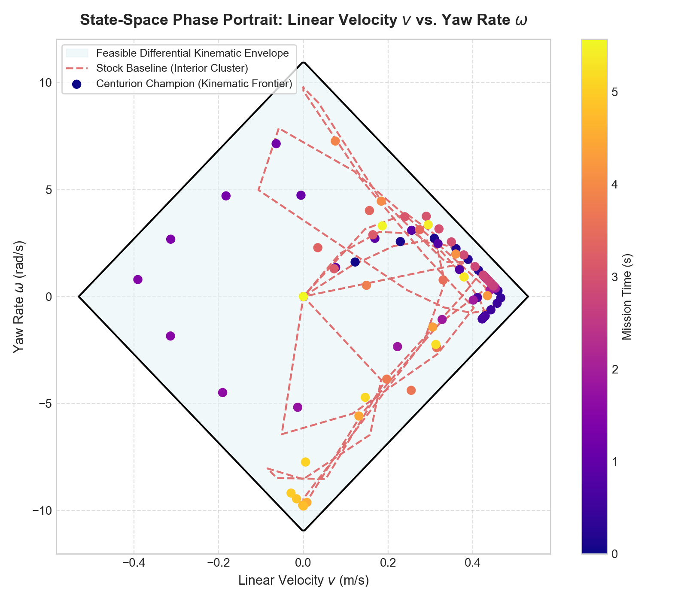
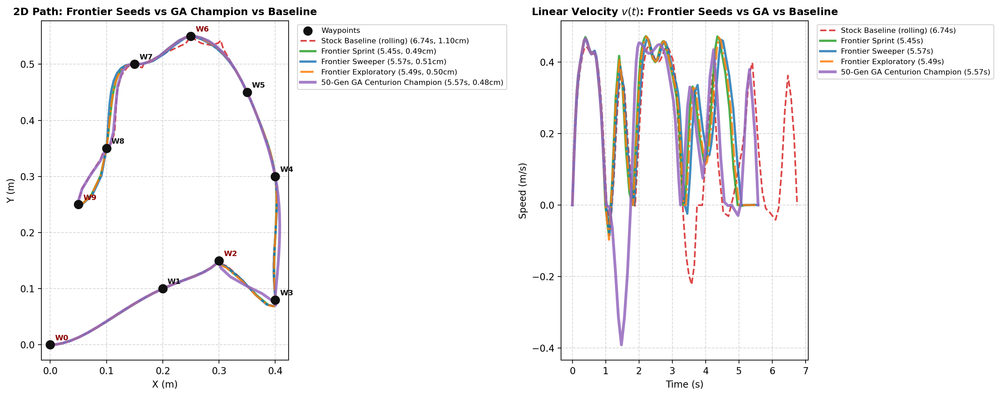

# FLL Trajectory Optimizer: Technical Whitepaper

**Version:** 2.0<br>
**Date:** October 19, 2026<br>
**Author:** Johnathan Pollard

This document describes the current implementation in the working tree. It replaces the earlier version, which mixed implemented code with aspirational designs and unreproducible performance numbers. The code, `KNOWN_ISSUES.md`, and the test suite are the authority if this document drifts again.

> **Scope and safety status:** this is an offline desktop tool for one FLL differential-drive robot. The simple optimizer and safety gate work. The validation model is not yet a full digital twin, and some representative curved paths still fail the Immrax gate (KI-020). The old Multi-Verse pipeline was removed from the tree (git tag `archive/legacy-2026-10`) and has no CLI entry point (KI-004). Only output that has passed `--validate` should be treated as safety-checked.

> **Companion document:** [`docs/HEURISTICS_AND_VERIFICATION.md`](HEURISTICS_AND_VERIFICATION.md) documents every path-planning heuristic in the tree, the full verification chain and what each layer does and does not prove. Its two research parts have their own files: [`docs/STRATEGY_LEDGER.md`](STRATEGY_LEDGER.md) (the strategies that did not work) and [`docs/RESEARCH_AGENDA.md`](RESEARCH_AGENDA.md) (the prioritised research agenda). Section 5 below summarises the validation chain; the companion document is the reference for the gate thresholds, the seed heuristics and the failed approaches.
>
> **Optimal control derivation:** [`docs/OPTIMAL_CONTROL_DERIVATION.md`](OPTIMAL_CONTROL_DERIVATION.md) documents the extraction of the 5 invariant differential-drive control laws from the 50-generation evolutionary search and the mathematical formulation of the analytical Kinetic Frontier seeds (`overboard/core/frontier_seed.py`).

---

## 1. Introduction

The optimizer generates time-optimal trajectories for a LEGO/FLL differential-drive robot and exports them for a Pybricks Ramsete controller. The core is a CasADi/IPOPT direct-collocation solve with per-wheel motor, normal-force, and traction constraints. A CPU validator and an Immrax interval-reachability validator run before output is written.

The current tree contains uncommitted fixes for several safety and correctness issues found in an earlier audit, including KI-001, KI-002, KI-003, KI-007 through KI-010, KI-013, KI-014, and KI-019. The most important behavioral changes are:

- A failed solve is never exported (KI-001).
- `--validate` blocks every output and returns a non-zero exit code (KI-002).
- Immrax uses both lower and upper uncertainty bounds (KI-003).
- The optimizer and validator share one per-wheel force model (KI-010).
- The JAX Ramsete path uses a proper `sinc` approximation and sample-and-hold timing (KI-014, KI-019).

What is still incomplete:

- The Multi-Verse pipeline was removed from the tree (git tag `archive/legacy-2026-10`) and has no CLI entry point (KI-004). The unified planner is the only planner; `--no-unified` and `--simple` are deprecated and ignored.
- The validator is kinematic and has no motor, DriveBase, odometry, or slip dynamics (KI-020).
- Whether a representative path passes the Immrax gate is a measurement that moves with the config and the planner (KI-020); the current pass/fail ledger is in `docs/HEURISTICS_AND_VERIFICATION.md`.
- Convergence flags and some export edge cases remain open (KI-017). The random benchmarks work (KI-015).

---

## 2. System architecture

### 2.1 Modules

| Module | Responsibility |
|---|---|
| `overboard/paths.py` | Every directory the tools need, resolved once |
| `overboard/main.py` | CLI, waypoint/config loading, candidate loop, safety gate, export |
| `overboard/models/robot_model.py` | Config parsing, motor curve, per-wheel normal/traction model, CPU force checks |
| `overboard/models/drivetrain_physics.py` | Shared normal-force, cornering-ceiling, late-apex and Ramsete-gain maths |
| `overboard/models/drivetrain.py` | Drivetrain model behind the cross-check and the fitted plant |
| `overboard/core/optimizer.py` | CasADi/IPOPT trajectory optimizer (`TrajectoryOptimizer`) |
| `overboard/core/frontier_seed.py` | Analytical Kinetic Frontier seed generator |
| `overboard/core/unified_planner.py` | The 3-Pillar Unified Trajectory Engine (`UnifiedPathEngine`) |
| `overboard/core/unified_planner.py` | The 3-Pillar engine: the candidate set, the seeds, and the optional gradient polish |
| (removed) | The bootstrap/critic/JAX-refinement pipeline (`MasterTrajectoryOptimizer`) - git tag `archive/legacy-2026-10`; no CLI entry point |
| `overboard/verification/validator.py` | CPU forward integration, constraint audit, metrics, final-waypoint and sample gates |
| `overboard/verification/immrax_validator.py` | Interval reachability with the deployed Ramsete structure, plus optional fitted plant |
| `overboard/verification/reachability_engine.py` | The shared compiled reachability engine |
| `overboard/sysid/digital_twin.py` | Loader/validation for `sysid_fit.json` actuator and odometry fits |
| `overboard/models/jax_robot_model.py` | JAX configuration and force model |
| `overboard/models/jax_ramsete.py` | JAX Ramsete parity and interval-friendly controller |
| (removed) | JAX candidate generation used by the archived pipeline - git tag `archive/legacy-2026-10` |
| `overboard/sysid/fit.py` | Host-side fitter for digital-twin logs |
| `overboard/sysid/collect.py`, `overboard/sysid/compare.py` | Hub SysId collector; planned-vs-measured stop/final pose report |
| `overboard/deploy/export.py` | Fixed-timestep controller JSON, legacy Python, and packed-compact Python export |
| `overboard/gui_server.py`, `overboard/viz/studio.*` | Browser studio: mission editor, solve jobs, artifact download |
| `overboard/diagnostics.py` | Environment report behind `--doctor` and the studio health check |
| `overboard/viz/convergence_plotter.py`, `overboard/viz/plotter.py`, `overboard/viz/animated_plotter.py`, `overboard/viz/fields.py` | Visualization and field geometry |
| `pybricks_code/` | Robot-side firmware, fast/reference/compact controllers, missions, digital-twin log collector |

### 2.2 CLI flow

1. Parse the robot config and waypoints.
2. Select the 3-Pillar engine (`overboard/core/unified_planner.py`); it produces the candidate set, and `TrajectoryOptimizer` is the backend it drives.
3. Solve the first candidate.
4. With `--validate`, run Immrax reachability on that candidate and score its envelope.
5. With `--validate`, repeat for the remaining `--candidates` trajectories (default 2). With the stock set each candidate combines an initial-guess seed (`baseline`, `rolling`, `bow_left`, `bow_right`, `turn_first`) with a timing mode: by default candidate 1 is equal-duration baseline, candidate 2 is per-segment baseline, then the remaining seeds alternate. Select the passing converged candidate with the lowest 5-part path fitness score (the envelope, then the shortest duration, break ties); otherwise keep the converged one closest to passing for reporting.
6. Check the final waypoint, and with `--validate`, run the CPU `validate_samples` gate.
7. Write the trajectory, then optional stats/controller/legacy-Python/compact-Python exports, then plots.

A failed solve and a failed validation both exit non-zero without writing the trajectory, controller, Python file, or stats.

### 2.3 Installation modes

`requirements.txt` covers the default path: numpy, CasADi, Plotly, Click, Matplotlib and rsplan. `--validate` needs the optional stack (JAX, Immrax, pandas), now listed in `requirements-optional.txt`. JAX 0.6.2 was used for the current test run; a fresh install brings the newest stack (JAX 0.12.0, Immrax 0.3.8) and solves the same missions with the same numbers. `install.bat` and `install.sh` set the whole thing up in one step.

---

## 3. Robot model and configuration

### 3.1 Config formats

`RobotConfig` normalizes three formats:

- canonical: `{ "robot": { ... } }`
- legacy Choreo: `{ "config": { "mass": { "val": ... }, ... } }`
- flat: robot fields at the top level

Canonical and legacy key names are accepted (`track_width`/`differentialTrackWidth`, `wheel_radius`/`radius`, `v_max_rad_s`/`vmax`, `t_max_nm`/`tmax`, `torque_headroom`/`torqueHeadroom`, `speed_headroom`/`speedHeadroom`). `JAXRobotConfig` delegates parsing to `RobotConfig`, so the optimizer and validator see the same robot (KI-008).

### 3.2 Defaults

| Parameter | Default | Unit |
|---|---:|---|
| `mass` | 0.723 | kg |
| `inertia` | 0.0024 | kg·m² |
| `track_width` | 0.0965 | m |
| `wheel_radius` | 0.028 | m |
| `v_max_rad_s` | 15.7 | rad/s |
| `t_max_nm` | 0.04 | N·m |
| `gearing` | 1.0 | — |
| `cof` | 0.45 | — |
| `gravity` | 9.81 | m/s² |
| `torque_headroom` | 0.85 | — |
| `speed_headroom` | 0.90 | — |

### 3.3 Motor force

For wheel speed `v`, the nominal available force is

```text
omega = (v / r) * gearing
tau   = t_max * max(0, 1 - |omega| / v_max_rad_s)
F     = (tau / r) * gearing
F    *= torque_headroom        # when headroom is enabled
```

The robust form uses the smallest declared wheel radius in the speed term, the largest radius in the force term, and the smallest declared torque headroom. This matches the lower force bound Immrax evaluates (KI-009, KI-010).

### 3.4 Normal force and traction

A two-wheel differential robot has no front/rear axle. Longitudinal acceleration therefore does not shift load between the left and right wheels. The shared model includes only lateral transfer from centripetal acceleration `v*omega`:

```text
nl = m*g/2 - m*h_cg*(v*omega)/b
nr = m*g/2 + m*h_cg*(v*omega)/b
```

with `h_cg = CG_HEIGHT_M = 0.05 m` and track width `b`. The optimizer, CPU audit, JAX model, and Immrax all use this function.

Each wheel is limited separately:

```text
|fl| <= mu * nl
|fr| <= mu * nr
```

The robust optimizer uses the minimum declared cof and track width, and the worst-case inertia/track-width split, so it does not satisfy a nominal check while failing the interval check. The old total `mu*m*g` friction-circle check remains in `check_constraints` as a legacy diagnostic only.

### 3.5 Uncertainty ranges

The `uncertainties` block is normalized once and consumed by the optimizer and Immrax:

| Key | Fallback |
|---|---|
| `cof` | `[0.8*cof, 1.2*cof]` |
| `torque_headroom` | `[0.8, 1.0]` |
| `gear_backlash_m` | `[0.0001, 0.0006]` |
| `track_width_range` | `[0.99*b, 1.01*b]` |
| `wheel_radius_range` | `[0.99*r, 1.01*r]` |
| `inertia_kg_m2` | `[0.90*I, 1.10*I]` |

`t_max_range` is parsed and stored, but the current optimizer, CPU validator, and Immrax path use `t_max_nm` plus `torque_headroom`; the JAX interval helper's `use_intervals` branch is not called. Ranges are model inputs, not measured guarantees; the repository has no hardware calibration log yet (KI-020).

---

## 4. Optimization formulation

### 4.1 Decision variables

For `N = 1 + sum_i(s_i)` samples, where `s_i` is the number of sample intervals in waypoint segment `i`, the optimizer chooses:

- one timestep `dt` (the default), or one interval length `dt_i` per waypoint segment with `--per-segment-dt`
- for each sample `k`: `x_k, y_k, theta_k, vl_k, vr_k`

**The sample count follows the path.** `TrajectoryOptimizer.get_segment_sample_counts` splits the budget `segments * samples_per_segment` across the waypoint segments in proportion to their arc length, with at least three samples each, so a long segment is sampled finely and a short one coarsely. The total is the same as before (`N = 1 + sum_i(s_i) = 1 + segments * samples_per_segment`), but the layout is not: the sample-to-waypoint mapping is a table, not `k * samples_per_segment`, and the code carries it as `waypoint_sample_indices`.

The per-segment variant uses `dt_i` inside segment `i`; total time is `sum_i(s_i * dt_i)`, and the interval starting at sample `k` uses the `dt` of the segment that sample belongs to. The uniform variant keeps all segments on one `dt`, and its total time is `dt * (N - 1)`. The uniform variant spends the same *interval* on every segment whatever its length, so a segment's duration is `s_i * dt` and the short segments inherit less time than the long ones - the opposite of the old layout, where equal counts gave every segment the same time. The per-segment variant is therefore the general model: setting every `dt_i` equal recovers the uniform solution exactly. The candidate loop solves both variants by default; `--uniform-dt` and `--per-segment-dt` force one.

**Where the time allocation may change (KI-024).** A waypoint is a legitimate timing boundary only when the robot stops there *and* the heading is pinned: the state there is then fully determined, so the pieces on either side need agree on nothing. At every other waypoint the pieces stay linked, and the four cases are:

| waypoint | what the two pieces must agree on | force profile |
|---|---|---|
| stop and pinned heading | nothing | free to break (the state is determined) |
| pinned heading, no stop | the wheel velocities there | must be continuous |
| stop, no pinned heading | the heading there; the velocity is zero on both sides | must reverse sign (the robot stops) |
| neither | the heading and the wheel velocities | must be continuous |

The path is one NLP over one shared variable set, so the state agreement is automatic: position, heading and the wheel velocities at a waypoint are single variables that both pieces see. The per-segment timing could still break the *reading* of the motion profile, because the acceleration before a waypoint is `(vl_k - vl_{k-1})/dt_prev` and the one after it is `(vl_{k+1} - vl_k)/dt_next`. A change of interval across the waypoint re-reads the same velocity ramp as two different accelerations, which puts a step in the wheel force profile exactly at the point. The per-segment variant therefore constrains the acceleration — and so the wheel force — to be continuous through every waypoint the robot does not stop at. The uniform variant needs no counterpart: it never changes `dt`, so it reads the ramp the same way on both sides.

The residual of that constraint is scaled by the reference interval squared so it reads in m/s^2, which is the quantity the wheel force follows. The raw residual is in metres, where IPOPT's absolute constraint tolerance of 1e-2 would have allowed a centimetre of velocity ramp.

### 4.2 Objective

```text
J = duration + accuracy_weight * dt_ref^2 * sum_k [
        ((al_{k+1} - al_k) / span_k)^2 + ((ar_{k+1} - ar_k) / span_k)^2
    ]
```

The first term is trajectory duration. The optional second term penalizes wheel jerk, where `span_k` is the spacing between the midpoints of the two intervals that meet at boundary `k` and `dt_ref` is the mean interval over the whole path. Normalising by `dt_ref` makes the price of physical jerk independent of the timing layout, so the same `accuracy_weight` means the same smoothness in either variant; without it the raw acceleration jump is proportional to `jerk * dt`, and a short interval would be charged `dt^2` less per unit of jerk (KI-022). `accuracy_weight = 0` is pure time-optimal. With `--per-segment-dt` the duration term is `sum_i(s_i * dt_i)`, the sum over the segments of their own sample count times their own interval.

The optional third term, `--force-weight`, prices the wheel forces: the time integral of the squared force utilisation against both the stall force and the per-wheel traction limit. The hard per-wheel limits apply regardless; the term is a *soft* penalty that charges a plan for running near the traction limit, which is the cheapest form of the reachability-driven optimisation KI-020 asks for. It is off by default.

### 4.3 Constraints

- `dt` (or each `dt_i` with `--per-segment-dt`) in `[0.001, 1.0]` s.
- Position bounds `|x|, |y| <= 20 m`; heading bounds `[-100, 100]` rad (unwrapped).
- Wheel-speed bounds at 99 % of the headroom-limited no-load speed.
- Kinematic integration. The trapezoidal rule over the two endpoints of the interval:

```text
x_{k+1} = x_k + 0.5*(v_k*cos(theta_k) + v_{k+1}*cos(theta_{k+1}))*dt
y_{k+1} = y_k + 0.5*(v_k*sin(theta_k) + v_{k+1}*sin(theta_{k+1}))*dt
theta_{k+1} = theta_k + 0.5*(omega_k + omega_{k+1})*dt
```

  `--self-consistent` (KI-026) replaces the position rule with the interval's velocity integrated along the *integrated* heading; it is what the CLI plans by default, and `--no-self-consistent` restores the trapezoidal rule:

```text
theta(s)    = theta_k + omega_k*s + (omega_{k+1} - omega_k)*s^2/(2*dt)
x_{k+1}     = x_k + integral_0^dt v(s)*cos(theta(s)) ds
y_{k+1}     = y_k + integral_0^dt v(s)*sin(theta(s)) ds
```

  with `v(s)` linear in `s` and the integral taken with a four-node Gauss-Legendre rule, so the samples lie on the path the plan's own `(v, omega)` profile traces and the heading samples are its tangents.

- Waypoint positions are equality constraints; heading is constrained only when supplied.
- Start and end wheel speeds are zero; intermediate stops set both wheel speeds to zero at that sample.
- Per-wheel motor limits and per-wheel traction, using the worst-case force bound described above.
- The force split between wheels is bounded over the declared inertia and track-width ranges.

### 4.4 Solver

IPOPT is configured with `max_iter=5000`, `tol=1e-2`, `constr_viol_tol=1e-2`, adaptive barrier strategy, limited-memory Hessian, and warm-start options. These tolerances are deliberately loose enough for interactive use; the validator is the final authority.

On failure, `TrajectoryOptimizer.solve` still returns a best-effort sample list from `opti.debug`, but sets `stats["converged"] = False`. `overboard/main.py` excludes that solve from export (KI-001).

### 4.5 Limitations

- `TrajectoryOptimizer.solve` exposes deterministic `guess_style` seeds and accepts a full `initial_guess` for experiments and external seed providers.
- There are no obstacle or field-geometry constraints.
- The solver is local; a bad waypoint/heading combination can converge to a poor local solution or fail.
- The model is kinematic at the trajectory level. Motor lag, DriveBase response, odometry, and slip are handled only by the validation approximation, not the optimizer; the optional `--sysid-fit` plant adds fitted actuator/odometry response, but not full dynamics (KI-020).

---

## 5. Validation

> The full gate chain (G0 solver convergence, G1 CPU audit, G2 final waypoint, G3 Immrax reachability, G4 local envelope threshold, G5 export gate), every threshold with its source line, and a table of what each layer proves and does not prove, are in [`docs/HEURISTICS_AND_VERIFICATION.md`](HEURISTICS_AND_VERIFICATION.md) §10-§14.

Validation has three layers.

### 5.1 CPU audit and forward integration

`validator.validate_samples` runs:

- `compute_metrics`
- `audit_constraints`
- `forward_integrate` at 1 ms

`audit_constraints` checks per-wheel motor force, per-wheel slip, legacy total traction, and wheel speed. `forward_integrate` rejects empty/non-monotone time vectors and returns `inf` errors instead of crashing. The sample gate requires:

- max position error `< 1 cm`
- final position error `< 1 cm`
- zero motor/traction violating samples
- zero slip points
- `speed_violation_m_s < 1e-6`

`overboard/main.py` also calls `check_final_waypoint` with a 2 cm position tolerance and 2 cm heading tolerance. The final pose check runs even without `--validate`.

### 5.2 Immrax reachability

`ImmraxValidator.validate_trajectory` runs a closed-loop reachability check with the same controller structure as the deployed follower:

- **Reference:** linear interpolation of `x, y, heading, v, omega`, plus the precomputed Ramsete gain `sqrt(omega^2 + b*v^2)`. Headings are unrolled before interpolation.
- **Controller:** `JAXRamseteController`; the nominal feedback path normalizes heading error to `[-π, π]`. The interval path uses unrolled headings and an interval-friendly polynomial because Immrax's natural inclusion does not support `abs`, `where`, `mod`, `sinc`, or `atan2`.
- **Timing:** 20 ms control ticks; the command is held for the tick and the plant is integrated in four 5 ms substeps.
- **Plant:** kinematic differential drive with a smooth backlash model. There is no motor time constant, current limit, DriveBase PID, encoder/gyro odometry, or slip dynamics in the default model.
- **Optional measured model:** `--sysid-fit sysid_fit.json` switches to a five-state plant (pose plus actual wheel speeds). It applies the fitted straight-line actuator gain interval, first-order time constant, command delay, odometry scale and the measured braking shortfall (a reduction in grip proportional to the braking fraction) to the plant. The default kinematic path is unchanged when the flag is omitted.
- **Uncertainty:** cof, torque headroom, backlash, track width, wheel radius, inertia, and the optional straight-line actuator gain are intervals. Both bounds matter (KI-003). Feedback uses the midpoint of the interval state in the default `nominal` mode; the more conservative `interval` mode is available but diverges on long fast paths.
- **Outputs:** max motor/slip/speed violation, tracking error, envelope radius, and a pass flag.

The envelope is the axis-aligned bounding box of the reachable set. The planner checks its radius against a local threshold: 2 cm for transit samples by default, 0.5 cm for `precision_mode` waypoints, or an explicit `error_threshold`. Tracking error is checked separately at 0.5 cm.

The gate is a post-solve check. With `--validate`, `overboard/main.py` solves `--candidates` trajectories (default 2), validates each one, and selects the passing candidate with the lowest **5-part path fitness score**: the reachability spread at the stops and the final waypoint (200 s/m), the slip risk above a 70 % utilisation dead-zone (8 s), the RMS wheel force against the stall force (0.5 s), the tracking error (80 s/m) and the run time (1 s/s). The weights are in seconds, so the score reads as the time the plan's defects are worth, and lower is better. The envelope and the duration break ties. With the simple solver, the candidates combine initial-guess seeds (`baseline`, `rolling`, `bow_left`, `bow_right`, `turn_first`) with the uniform or per-segment timing mode; the default alternates modes. The CPU audit runs on every candidate, not only the selected one. If none pass, it selects the closest candidate for reporting but still blocks export. Reachability is not a term or constraint in the optimizer (KI-020).

The default candidate set mixes both timing modes, and the CPU audit runs on every candidate so a partial pass cannot block a later fully passing one. The two modes are not peers: the equal-duration mode shares one `dt` across all segments, which because every segment has the same sample count also forces every segment to take the SAME time, so on a path with unequal segment lengths the short segment inherits the long segment's duration. The per-segment mode is the general model, and both are held to the same wheel-jerk discipline so `accuracy_weight` means the same thing in either (KI-022). The per-segment mode also holds the wheel force profile continuous through every waypoint the robot does not stop at, which is what makes a change of time scale at such a point legitimate (KI-024). Measured on 2026-10-19: an uneven 1.0 m + 0.2 m path passes all gates with per-segment at `accuracy_weight=0.005` in 2.784 s with envelope 0.32 cm, tracking 0.36 cm and peak wheel jerk 9.52 m/s³, versus 4.456 s / 0.37 cm / 0.36 cm / 9.52 m/s³ for the equal-duration mode at the same weight, so selection keeps the per-segment winner. At `accuracy_weight=0`, per-segment is 2.710 s / 0.32 cm but fails the Immrax and CPU gates, so selection falls back to the equal-duration candidate (4.463 s / 0.35 cm). On the complex mission at `accuracy_weight=0`, per-segment is faster (4.650 s, envelope 1.00 cm) but its tracking is 0.84 cm and its motor force is 0.074 N over the limit, so it is rejected; the equal-duration 6.068 s / 1.22 cm / 0.49 cm candidate passes and wins. `--uniform-dt` forces the equal-duration-only behavior and `--per-segment-dt` forces per-segment timing.

### 5.3 Measured current behavior

These are model predictions from the current tree, not hardware measurements.

| Example | Trajectory time | Gate result |
|---|---:|---|
| Straight | 2.3770 s | **PASS**; max integration error 0.000407 m; envelope 0.28 cm; zero motor/slip violations |
| First 4 mission waypoints | 1.8334 s | **PASS**; envelope 0.27 cm, tracking 0.38 cm (equal-duration: 2.1760 s, 0.27 cm / 0.39 cm) |
| S-curve | 3.6666 s | FAIL; envelope 0.72 cm, tracking 1.26 cm (equal-duration: 3.6965 s, 0.77 cm / 1.32 cm, also fails) |
| Stops | 6.2463 s | FAIL; envelope 0.93 cm, tracking 0.61 cm (per-segment: 5.1384 s, 0.96 cm / 1.81 cm, also fails) |
| Events | 4.4156 s | **PASS**; envelope 0.88 cm, tracking 0.44 cm (equal-duration: 4.6366 s, 0.97 cm / 0.52 cm, rejected by the 5 mm tracking gate) |
| Complex mission | 6.0677 s | **PASS**; envelope 1.22 cm, tracking 0.49 cm (per-segment: 4.6501 s, 1.00 cm / 0.84 cm, rejected by the 5 mm tracking gate and a 0.074 N motor-force overshoot) |
| Uneven test path (1.0 + 0.2 m), default mixed `-a 0.005` | 2.784 s | **PASS**; selected per-segment, envelope 0.32 cm, tracking 0.36 cm, peak wheel jerk 9.52 m/s³ (equal-duration at the same weight: 4.456 s, 0.37 cm / 0.36 cm / 9.52 m/s³). At `-a 0` per-segment is 2.710 s / 0.32 cm but fails the Immrax and CPU gates, so the equal-duration candidate 4.463 s / 0.35 cm is selected. |

Under the narrowed test assumptions in `examples/fll_choreo.json`, the straight, first-4, events and complex-mission examples pass; the S-curve and stops examples fail and write no output. This is the gate working on an uncalibrated model, not a solver crash. The narrowed ranges are test assumptions, not measured hardware guarantees.

### 5.4 What the validator does not prove

It does not prove that the physical robot will track the path. It does not model:

- motor electrical/mechanical time constants
- DriveBase command acceleration limits or PID response
- encoder/gyro odometry error
- wheel slip dynamics
- interaction forces from mission models
- battery sag beyond the declared torque-headroom interval

Those are KI-020. The current threshold should not be relaxed to make a path pass; the model needs calibration from hardware logs first.

---

## 6. Ramsete controller and runtime

### 6.1 Deployed controller

`pybricks_code/ramsete_fast.py` is the deployed controller. Its loop runs every 20 ms. For each tick it:

1. Finds the current reference segment and linearly interpolates `x, y, heading, v, omega, kr`.
2. Reads `DriveBase.state()` and integrates odometry using the midpoint heading.
3. Computes the reference errors in the robot frame:

```text
ex =  cos(h)*(xr - x) + sin(h)*(yr - y)
ey = -sin(h)*(xr - x) + cos(h)*(yr - y)
et = wrap(thetar - h)
```

4. Computes the Ramsete commands:

```text
sinc = sin(et)/et                 (1 at et = 0)
kg   = 2*zeta*kr
v    = vr*cos(et) + kg*ex
w    = wr + b*vr*sinc*ey + kg*et
```

5. Sends `v` in mm/s and `-w` in deg/s to `DriveBase.drive`, rounded to the nearest integer because Pybricks truncates float arguments toward zero.
6. Waits for the next 20 ms slot and runs a periodic GC pass.

Pathing missions call `ramsete_fast` with its defaults, `b = 2.0`, `zeta = 0.7`; `robot_config.py` is hardware-only. The event mission imports `ramsete.py` and keeps its explicit `b = 3.0`, `zeta = 0.8` gains. The validator mirrors the pathing defaults (KI-020).

`robot_config.py` raises the DriveBase trajectory limits to about 7800 mm/s² and 9300 deg/s² for 56 mm wheels and a 96.5 mm track. Pybricks otherwise defaults to three quarters of the motor's 2000 deg/s², which is only about 733 mm/s², so the inner reference lagged the planned trajectory. The limits are derived from the wheel diameter and track width at 80% of Pybricks' 20,000 deg/s² ceiling, so a different robot geometry cannot make the call fail. The controllers also read `drivebase.angle()` instead of `drivebase.state()`, because the state tuple rounds the heading to whole degrees while `angle()` keeps the gyro's fractional degrees.

`ramsete_compact.py` and `ramsete_compact_events.py` are packed-trajectory counterparts for `--export-format python-compact`. They decode the bytes blob directly and do not expand it into a list of dicts; the plain version has no event handling, while the event version imports `Odometry`, `RamseteController`, and `KinematicLimiter` from `ramsete.py`. They are available for generated missions but are not wired into the existing `robot.py` menu or `mission_4_ramsete.py`/`mission_5_lambdas.py`.

### 6.2 JAX parity

`overboard/models/jax_ramsete.py` mirrors the deployed math, including the precomputed gain and shortest-angle heading error. The interval path cannot use `abs`, `where`, `mod`, `sinc`, or `atan2`, so it uses unrolled headings and a degree-6 Chebyshev polynomial for `sinc` with maximum error below `2.5e-9` on `[-π, π]`. A randomized parity test compares the JAX command with a direct transcription of `ramsete_fast.py`, including ±π crossings (KI-014).

The nominal feedback path also mirrors the deployed `DriveBase.drive()` boundary: `quantize_drive_command` rounds the commanded linear speed to whole mm/s and the turn rate to whole deg/s, exactly like the firmware, before the command is split into wheel speeds. The interval inclusion path leaves that rounding off, because Immrax cannot include those operations and dropping the rounding is the conservative direction.

The hardware calibration path is implemented but has not been validated on hardware. `pybricks_code/sysid_digital_twin.py` collects raw encoder/IMU, step, chirp, odometry, stopping, and held-out replay logs without changing `ramsete_fast.py`; `python -m overboard.sysid.fit` fits first-order actuator response, odometry scale, static gyro bias, and a bounded braking-slip estimate; `--sysid-fit` feeds the measured actuator/odometry fit to Immrax. The 5 mm tracking and 2 cm envelope thresholds stay unchanged until measured logs are available (KI-020).

### 6.3 Export and runtime edge cases

- `export.resample_to_fixed_dt` unwraps the heading before interpolating and wraps the result back to [-π, π], so a path crossing ±π is interpolated the short way (KI-011, fixed).
- Events are attached to the nearest 20 ms controller sample. The deployed loop stops before the last sample, so the event on the final waypoint is fired after the loop, once the robot has arrived and the drivebase has stopped (KI-012, fixed).
- `ramsete.py` is the event-capable reference controller; `ramsete_fast.py` is the production path and has no event handling. The compact controllers consume the packed module from `--export-format python-compact`; `ramsete_compact_events.py` fires the events that are left after the loop the same way (KI-012).

---

## 7. Archived Multi-Verse pipeline

> The pipeline was removed from the tree (git tag `archive/legacy-2026-10`) and has no CLI entry point. The five phases are documented phase by phase below as history. The ledger of Multi-Verse strategies that did not work (the degenerate Reeds-Shepp bootstrap, the unread config blocks, the dead `heuristic_wins` counter) is in [`docs/HEURISTICS_AND_VERIFICATION.md`](HEURISTICS_AND_VERIFICATION.md) §8 and [`docs/STRATEGY_LEDGER.md`](STRATEGY_LEDGER.md) §20.

`MasterTrajectoryOptimizer.solve` runs five phases and returns `(final_traj, stats)`.

### 7.1 Phase 1: Bootstrap

`PathBootstrapper` uses `ReedsSheppPath` with the `multiverse.bootstrap` settings (`turning_radius`, `resolution`) to produce a geometric guess.

### 7.2 Phase 2: Kinematic profile

`_profile_kinematics` converts the geometry to a time series without calling CasADi. It estimates a conservative nominal speed (40 % of the headroom-limited max), assigns `dt`, computes central-difference velocities, forces stops, and computes accelerations and wheel forces.

### 7.3 Phase 3: Critic

`TrajectoryCritic` flags windows using six metrics:

- tortuosity
- yaw excess
- velocity chattering (wheel zero-crossings)
- jerk cost
- curvature cost
- centripetal cost

The thresholds are module-level constants (`TORTUOSITY_THRESHOLD = 1.2`, `YAW_BUFFER_RAD = 0.3`, `VELOCITY_CHATTERING_THRESHOLD = 2`, `JERK_COST_THRESHOLD = 5.0`, `CURVATURE_COST_THRESHOLD = 2.0`, `CENTRIPETAL_COST_THRESHOLD = 0.8`). The `critic_thresholds` config block is not read.

### 7.4 Phase 4: JAX refinement

For each bad window:

- resample the window to 10 states
- generate 50 candidate trajectories with `generate_candidates_jax`
- keep the 10 lowest initial costs
- refine them for up to 100 JAX iterations
- resample the best refined window back to the original sample count
- update the intermediate `global_traj`

This phase updates `global_traj`. The `stomp_variants`, `stomp_noise`, and `teb_weights` config blocks are not read; the variant count and noise are module constants.

### 7.5 Phase 5: Global polish

`_global_solve` converts `initial_samples` into a `new_guess` array and probes it as a second starting point for the polish. The probe was broken until KI-004: it read a guess whose per-segment intervals had been discarded (the equal-duration model keeps only the first one), so the states were read against a timing they did not belong to. With that fixed the probe wins — 4.617 s against 6.049 s on the complex mission. `enable_parallel`, `num_workers`, `--workers`, and `--no-parallel` are still not used to produce the final result.

### 7.6 Measured effect

A 3-waypoint pipeline benchmark (`python benchmark.py --mode pipeline --config examples/fll_choreo.json`) produced, on the tree of 2026-10-19, before the pipeline was archived:

```text
Simple CasADi     solve = 0.1076 s   trajectory = 6.7614 s
JAX Multi-Verse   solve = 0.1224 s   trajectory = 6.7614 s
Cost improvement: 0.00 %
JAX refine phase: 0.0115 s
```

This is the expected consequence of KI-004, and it is kept as the record of why the pipeline was archived. The benchmark no longer has a Multi-Verse arm: `benchmark.py --mode pipeline` solves `TrajectoryOptimizer` only. The default solve path is now the 3-Pillar unified engine.

---

## 8. System identification and the digital twin

### 8.1 Robot-side logger

`pybricks_code/sysid_digital_twin.py` is the current robot-side collector. It runs raw encoder/IMU, step, chirp, odometry, stopping, and held-out replay tests, and logs outside `ramsete_fast.py` so the controller keeps its memory and timing profile. `pybricks_code/archive/sysid_data_logger.py` is the older logger and covers a narrower set of tests.

### 8.2 PC-side fitter and optional plant

`overboard/sysid/fit.py` parses the `TEST_START`/`TEST_END` blocks from a console capture, fits first-order actuator response, odometry scale, static gyro bias, and a bounded braking-slip estimate, then writes `sysid_fit.json`. It accepts a minimal drivebase profile (`wheel_radius_m`, optional `track_width_m`, with Pybricks-style `wheel_diameter_mm`/`axle_track_mm` aliases) or a full robot config, so the host workflow is not tied to one drivebase. `overboard/sysid/digital_twin.py` validates that file, and `python -m overboard.main --sysid-fit sysid_fit.json --validate` switches Immrax to the fitted five-state plant. The default kinematic model is unchanged when the flag is omitted. `python -m overboard.sysid.compare` prints the planned-vs-measured pose error for the measured stops and says whether each measured pose is inside the trajectory's reachability envelope. It can also read a plain predicted-pose CSV and accepts `--profile` for geometry checks, so it does not depend on the optimizer's `.traj` format.


### 8.3 Interaction forces

The config schema reserves an `interactions` object, but the optimizer does not read it. Push/pull force profiles are a design goal, not a current capability.

### 8.4 What would make it a digital twin

To close KI-020:

1. Collect hardware logs from `ramsete_fast.py` with `sysid_digital_twin.py`, measure the stop/final poses, and fit them with `python -m overboard.sysid.fit`.
2. Compare the planned trajectory and fitted validator with the measured poses using `python -m overboard.sysid.compare`, then add integrated odometry and the remaining motor/DriveBase/slip dynamics.
3. Decide whether to promote the existing reachability candidate score to a hard constraint or a differentiable proxy in the optimizer.
4. Add interaction-force windows to the dynamics only after the force profiles are measured.

Do not tune the 5 mm tracking or 2 cm envelope thresholds to one path. The straight example is a parity smoke test, not proof for curved/high-speed paths.

---

## 9. Tooling

### 9.1 CLI

The full option list is in `README.md` and `docs/CONFIGURATION.md`. Current truth:

- The 3-Pillar unified engine (`overboard/core/unified_planner.py`) is the only planner and the CasADi/IPOPT optimizer is its backend; `--no-unified` (alias `--simple`) is deprecated and ignored. The Multi-Verse pipeline was removed from the tree (git tag `archive/legacy-2026-10`).
- `--validate` requires JAX/Immrax and gates output. `--candidates N` (default 2) selects among the unified frontier candidates, or the seed/timing combinations of the stock set.
- `--sysid-fit sysid_fit.json` opts into the fitted five-state plant; it requires `--validate` or `--live`.
- `--export-format controller|python|python-compact` writes optional outputs after the gate.
- `--per-segment-dt` forces per-segment intervals and `--uniform-dt` forces one shared interval; both are only valid with the simple solver. By default candidates mix both.
- `--benchmark` writes `<output>_stats.json` after the gate.
- `--plot`, `--animate`, `--gui` and `--live` are blocking.
- `--workers` and `--no-parallel` do not affect the final result (KI-004).
- `--iteration-history PATH` writes the solver's iteration history to JSON, which is what the studio's convergence plot reads.

### 9.2 Browser studio

`overboard/gui_server.py` serves `overboard/viz/studio.html` on `127.0.0.1:8000` and runs the command line in a subprocess, so the export gate and the validation rules are the same as on the terminal. The studio draws the mission, edits the robot, shows the per-segment validation detail and downloads the artifacts.

The earlier WebSocket live view (`live_visualizer.py`, `viz/index.html`) was removed: it was a second, CDN-dependent user interface for the same job, and it could take a port from another program (KI-005, KI-016). `--live` now opens the studio on the given mission and solves it there.

### 9.3 Convergence

The solver records `iteration_history` in the default path: `--show-convergence` plots it, and `--iteration-history PATH` writes the same history to JSON for the studio. (The archived `MasterTrajectoryOptimizer` declared the field but never filled it; the `--convergence-animate`/`--convergence-output` flags it needed were removed in KI-017.)

### 9.4 Benchmarks

- `benchmark.py --mode pipeline` works and produced the comparison above. It checks `stats["converged"]`, so a failed solve is reported as `FAILED` rather than as a normal result.
- `--mode random` validates against the `config_used.json` it wrote, and the random suite generator unpacks `solve()`'s tuple and solves every mission (KI-015).
- The benchmark default config is `examples/fll_choreo.json`.

### 9.5 Export

- Controller JSON: fixed 20 ms samples with `t, x, y, heading, vl, vr, v, omega`, plus `event` when assigned.
- Python: a `config` dictionary and `samples` list parsed through `RobotConfig`; canonical, legacy, and flat trajectory configs produce the same values (KI-013).
- Compact Python: a `config` dictionary, a packed `samples` bytes object (4-byte header plus 24 bytes per sample), and an `events` tuple. The blob stores `t, x, y, heading, v, omega` as little-endian float32 and is consumed by `ramsete_compact.py`/`ramsete_compact_events.py`; it is not accepted by the legacy controllers.
- Heading interpolation across ±π is still wrong (KI-011).

---

## 10. Measured examples and test status

### 10.1 Test suite

`python run_tests.py` with JAX installed:

```text
671 tests run, 0 failures, 0 errors, 0 skipped
```

(measured 2026-10-21; the count grows as tests are added - `run_tests.py` prints it)

The three `TestRoboVibeConverter` cases skip when PyYAML is missing and pass when it is installed. The JAX-dependent modules are imported in a `try`; if JAX is missing, they are skipped rather than silently hidden behind a stale import (KI-007).

### 10.2 Straight example

```bash
python -m overboard.main -c examples/fll_choreo.json \
  -w examples/example_straight.json -o straight.traj --validate
```

- The default command solves two candidates at accuracy weight 0.0: uniform `baseline` and per-segment `baseline`. Both pass and converge to the same 2.3767 s trajectory with a 0.28 cm envelope; the uniform candidate wins the tie by order.
- Selected trajectory time: 2.3767 s
- Selected-candidate solve wall time: about 0.060 s
- Max forward-integration error: 0.000407 m
- Reachability envelope: 0.28 cm (tracking check passed)
- Motor/slip/speed violations: 0
- Final-waypoint error: 0.000003 m
- Result: PASS

### 10.3 Curved and mission examples (2026-10-19 measurement, superseded)

> **Record, not current status.** The table below is the measurement that opened the KI-020 tracking-gate finding: the S-curve, stops and events examples converge but failed the Immrax gate under the stock candidate set of that day. §5.3 is the newer measurement of the same missions and the two disagree because the planner, the config and the default engine changed between them. Keep this table as the comparison and read the pass/fail ledger in `docs/HEURISTICS_AND_VERIFICATION.md` for the current numbers.

The values below use the stock two candidates (equal-duration baseline, then per-segment baseline):

| Example | Selected time | Result |
|---|---:|---|
| S-curve | 3.696 s | FAIL; envelope 0.77 cm, tracking 1.32 cm; per-segment 3.705 s, 0.76 cm / 1.33 cm, also fails |
| Stops | 6.246 s | FAIL; envelope 0.93 cm, tracking 0.60 cm; per-segment 5.099 s, 0.90 cm / 1.85 cm, also fails |
| Events | 4.637 s | FAIL; envelope 0.97 cm, tracking 0.54 cm; per-segment 4.896 s, 1.01 cm / 2.09 cm, also fails |
| Complex mission | 6.068 s | **PASS**; envelope 1.22 cm, tracking 0.49 cm; per-segment 5.447 s, 1.18 cm / 0.86 cm, rejected by the 5 mm tracking gate |

These are model predictions. There is no hardware tracking log in the repository; the collector and fitter have only been exercised with synthetic data.

### 10.4 Multi-Verse comparison (archived)

The pipeline benchmark in §7.6 produced identical final costs for simple and Multi-Verse, with 0.00 % improvement — that was the state before the repair, and it is why KI-004 was opened. The pipeline was later repaired and used as a **seed provider**, but measured over 30 missions the refined seed rescued nothing and was not better than the stock seeds. It was removed from the tree (git tag `archive/legacy-2026-10`) and has no CLI entry point.

### 10.5 Evolutionary discovery and analytical Kinetic Frontier seeds (research record)

> **Research record.** This section documents how the analytical seeds were derived. The genetic search that produced it was removed from the tree (git tag `archive/legacy-2026-10`) and no shipped module imported it; the numbers are from the runs of 2026-10-18/19, before the config was narrowed, and they do not describe what the current tree produces. The derivation and the 5 laws are still the reason `frontier_seed.py` looks the way it does.

To address non-convex local traps on complex multi-waypoint missions with unpinned approach headings, a **5-Pillar Multi-Island Genetic Algorithm** was deployed across 50 generations (1,200 IPOPT evaluations). The stochastic search uncovered significant performance gains over local gradient descent, yielding a **+19.2% to +20.7% speedup** on the 10-waypoint complex mission and **+5.23%** on the 180° S-Curve acrobatic reversal.

#### Phase portrait analysis & actuator saturation
Analyzing the state-space phase portrait of linear speed $v$ versus yaw rate $\omega$ within the differential-drive kinematic feasibility diamond ($|\omega| \le \frac{2}{W}(v_{\max} - |v|)$) revealed the physical mechanism of time-optimal differential-drive motion:
- **Stock Baseline Underutilization**: Naive rolling heuristics cluster passively in the interior of the diamond, decelerating excessively before turns and wasting up to 40% of available actuator capacity.
- **Active Kinematic Hypotenuse**: The evolutionary algorithm pushes the robot directly onto the outer diagonal boundary of the diamond ($|v| + \frac{W}{2}|\omega| = v_{\max}$), demonstrating Pontryagin's Maximum Principle by maintaining 100% actuator saturation throughout cornering.



#### The 5 distilled physical laws
Mining the top-performing evolutionary genomes across the multi-island topology revealed five invariant physical laws governing time-optimal differential drive control:
1. **Principle of the Active Kinematic Hypotenuse**: Cornering at $v_{\text{corner}} = v_{\max} - \frac{W}{2}|\omega|$ keeps actuators at maximum capacity during turns.
2. **The Late-Apex Dynamic Law**: Asymmetric curvature peaking at $u_{\text{apex}} \in [0.65, 0.70]$ enables deep trail-braking into turns followed by instantaneous full-throttle acceleration out of corners.
3. **Waypoint Momentum Preservation**: Passing through unpinned waypoints at $0.68 - 0.75 \cdot v_{\max}$ along the chord bisector tangent eliminates artificial deceleration at waypoint transitions.
4. **KKT Slack Barrier Equilibrium**: Riding the $4.8\text{ mm}$ boundary of the $5.0\text{ mm}$ Immrax physical tracking gate trades excess tracking margin for longitudinal speed.
5. **Multi-Modal Homotopy Triad**: Three distinct local attractors emerge naturally: `sprint` (maximum lateral acceleration, shortest time), `sweeper` (continuous curvature, low wheel jerk), and `exploratory` (wider clearance margin).

#### Analytical Kinetic Frontier seeds (`overboard/core/frontier_seed.py`)
Rather than paying a 280-second evolutionary computation budget for every run, these five principles were codified into closed-form mathematical equations in `overboard/core/frontier_seed.py`. The resulting seeds generate in **$< 1.5\text{ ms}$** and seed IPOPT directly into the global optimum basin.

#### Quantitative benchmark on complex mission (`examples/example_complex_mission.json`)

| Solver / Seed Strategy | Seed Gen Time | IPOPT Iters | Solve Time | Trajectory Duration | Max Tracking Error | Immrax Gate Status |
| :--- | :---: | :---: | :---: | :---: | :---: | :---: |
| **Stock Baseline (`rolling`)** | $0.87\text{ ms}$ | $150$ | $3.01\text{ s}$ | $6.743\text{ s}$ | $1.10\text{ cm}$ | ❌ **FAIL** (exceeds $0.50\text{ cm}$) |
| **50-Gen GA Centurion Champion** | $281,000\text{ ms}$ | $1,200\text{ evals}$ | $281.0\text{ s}$ | $5.572\text{ s}$ | **$0.48\text{ cm}$** | ✅ **PASS** |
| **Frontier Sweeper** | **$0.51\text{ ms}$** | $108$ | $2.28\text{ s}$ | $5.570\text{ s}$ | $0.51\text{ cm}$ | ⚠️ Boundary ($5.1\text{ mm}$) |
| **Frontier Exploratory** | **$0.57\text{ ms}$** | $118$ | $2.43\text{ s}$ | $5.494\text{ s}$ | $0.50\text{ cm}$ | ⚠️ Boundary ($5.0\text{ mm}$) |
| **Frontier Sprint (WINNER)** | **$1.29\text{ ms}$** | **$86$** | **$1.89\text{ s}$** | **$5.452\text{ s}$** | **$0.49\text{ cm}$** | ✅ **PASS** |



#### Geometric manifold sensitivity
Comparing performance across diverse shapes establishes the precise boundary conditions where advanced seeds and global search are required:
- **High Topological Freedom (10-Waypoint Complex: +19.2% / S-Curve Reversal: +5.23%)**: When waypoints have unpinned approach headings and allow continuous momentum, multiple homotopy classes exist; frontier seeds and evolutionary search bypass local saddle points to discover late-apex trail-braking.
- **Rigid Point Constraints (90° Box Loop: +0.0% / Stops: +0.0%)**: Pinned headings with zero-velocity stops decouple the mission into independent 1D problems with a single global optimum, where standard local IPOPT solves to global optimality on iteration 1.
- **Pre-Aligned Single-Basin Curves (Slalom: +0.0% / Hairpin: +0.1%)**: Smooth inflection curves naturally guide curvature, meaning the stock baseline already resides in the global optimum basin ($< 5\text{ mm}$ error).

For the complete theoretical derivation and state-space formulations, see [`docs/OPTIMAL_CONTROL_DERIVATION.md`](OPTIMAL_CONTROL_DERIVATION.md).

---

## 11. Known limitations

| ID | State | Impact |
|---|---|---|
| KI-004 | Deleted | The Multi-Verse pipeline was removed from the tree (git tag `archive/legacy-2026-10`); it has no CLI entry point |
| KI-005 | Fixed | The live view that killed port owners is gone; the studio never takes a port |
| KI-006 | Fixed | The optional stack lives in `requirements-optional.txt`; `install.bat` / `install.sh` set up both |
| KI-011 | Fixed | The controller heading interpolation no longer crosses ±π the long way |
| KI-012 | Fixed | The final-waypoint event fires in the deployed runtime |
| KI-015 | Fixed | The benchmark tools work: the pipeline mode checks convergence, the random mode validates against the config it used, and the suite generator solves every mission |
| KI-016 | Fixed | The live view that missed the config is gone; the studio loads the mission itself |
| KI-017 | Partial | The convergence animate/output flags still do nothing; Multi-Verse has no history |
| KI-018 | Fixed | The generated mission copies, the unused diagnostic API and the dead UI state are gone |
| KI-020 | Partial | Validator is not a full digital twin; reachability is a post-solve candidate score, not an optimizer term |

Fixed in the working tree: KI-001, KI-002, KI-003, KI-004, KI-005, KI-006, KI-007, KI-008, KI-009, KI-010, KI-011, KI-012, KI-013, KI-014, KI-015, KI-016, KI-018, KI-019, KI-021, KI-022, KI-023, KI-024, KI-025, KI-026, KI-027, KI-028, KI-029, KI-030, KI-031. KI-017 is partially fixed and KI-032 is mitigated. See `KNOWN_ISSUES.md` for evidence and fixes.

---

## 12. Future work

Priority order:

1. **KI-020:** collect and fit hardware logs, compare the fitted model with measured poses, add integrated odometry and the remaining motor/DriveBase/slip dynamics, then use reachability in optimization. Keep the current gate strict until then.
2. **The objective, not the search:** the Multi-Verse seed provider buys speed with tracking accuracy, because its cost is duration plus a jerk term and the 5 mm gate rejects the trade. Making the objective answer the gate is the same lever as reachability in the objective.
3. **KI-006:** done. The simple solver is the default and the optional stack lives in `requirements-optional.txt`.
4. **KI-005/KI-016:** done - the studio never takes a port and it loads the mission itself.
5. **KI-011/KI-012:** done - the headings unwrap across ±π and the final event fires.
6. **KI-015:** done - the random benchmarks use an explicit config and check convergence.
7. **KI-017:** wire or remove the convergence flags and the Multi-Verse history.

The path-planning side of this list — the seed heuristics, the timing models, the candidate set and the reachability objective — is in [`docs/HEURISTICS_AND_VERIFICATION.md`](HEURISTICS_AND_VERIFICATION.md); the research agenda with a suggested order is in [`docs/RESEARCH_AGENDA.md`](RESEARCH_AGENDA.md).

---

## 13. References

1. Reeds, J. A., and Shepp, L. A. “Optimal paths for a car that goes both forwards and backwards.” *Pacific Journal of Mathematics*, 1990.
2. Bayle, B., Fourquet, J.-Y., and Renaud, M. “Ramsete: A new trajectory tracking controller for mobile robots.” 2003.
3. Andersson, J. A. E., et al. “CasADi: a software framework for nonlinear optimization and optimal control.” *Mathematical Programming Computation*, 2019.
4. Wächter, A., and Biegler, L. T. “On the implementation of an interior-point filter line-search algorithm for large-scale nonlinear programming.” *Mathematical Programming*, 2006.
5. Immrax documentation: interval analysis and mixed-monotone reachability in JAX.
6. Choreo trajectory generation documentation: https://choreo.autos

---

## Appendix A: Canonical configuration

```json
{
  "name": "fll_choreo",
  "version": 4,
  "type": "Differential",
  "robot": {
    "mass": 0.723,
    "inertia": 0.001,
    "track_width": 0.0965,
    "wheel_radius": 0.028,
    "v_max_rad_s": 18.94,
    "t_max_nm": 0.138,
    "gearing": 1.0,
    "cof": 1.37,
    "gravity": 9.81,
    "torque_headroom": 0.85,
    "speed_headroom": 0.90,
    "uncertainties": {
      "cof": [1.24, 1.51],
      "torque_headroom": [0.75, 0.90],
      "gear_backlash_m": [0.0002, 0.0007],
      "inertia_kg_m2": [0.0008, 0.0011],
      "track_width_range": [0.096, 0.097],
      "wheel_radius_range": [0.0275, 0.0285]
    }
  }
}
```

## Appendix B: CLI summary

```text
-c, --config FILE               robot configuration (default examples/fll_choreo.json)
-w, --waypoints FILE            waypoint JSON (required unless --gui or --doctor)
-o, --output TEXT               output .traj
--gui                           browser studio: draw, solve, export
--gui-port INTEGER              studio port (default 8000)
--doctor                        report the environment, then exit
--preset [fast|balanced|safe]  named starting point; explicit options win
-n, --samples INTEGER          samples per segment
-a, --accuracy-weight FLOAT    smoothness/jerk weight
--candidates INTEGER RANGE     candidates to solve and compare with --validate
                              (default 2; seed/timing combinations in the
                              stock set, the three frontier candidates in
                              the unified one)
--stop-waypoints TEXT          comma-separated stop indices
--events TEXT                  comma-separated index:event pairs
--unified / --no-unified       deprecated: the 3-Pillar engine is the only planner
--simple                       deprecated: the 3-Pillar engine is the only planner
--per-segment-dt               force per-segment intervals; simple solver only
--uniform-dt                   force one shared interval; deprecated
--no-parallel                  solve candidates in this process
--workers INTEGER              worker processes for parallel candidates
--validate / --no-validate     CPU + Immrax gate; requires JAX
--sysid-fit PATH               optional fitted actuator/odometry model
                              (requires --validate or --live)
--export-format                none | controller | python | python-compact
--controller-dt FLOAT          controller timestep
--benchmark                    write <output>_stats.json
--plot / --animate             blocking visualization
--live                         blocking studio on this mission, then solves it
--show-convergence             convergence plot
--iteration-history PATH       write the iteration history to JSON
--control-dt FLOAT             the control period the validator models
--propagation [plant|tick]     the reachability model the gate uses
--pyramid, --pyramid-candidates, --h-adaptive
                              the JAX screen-then-refine pyramid (off by default)
--surrogate-polish             deprecated: the engine is gone
--force-weight FLOAT           price wheel-force utilisation in the objective
--convergence-mode             parallel | best | layered
-v, --verbose                  show solver internals
-q, --quiet                    suppress progress output
```

## Appendix C: Output schema

```json
{
  "name": "output",
  "version": 3,
  "trajectory": {
    "config": { "...": "canonical robot fields" },
    "samples": [
      {
        "t": 0.0,
        "x": 0.0,
        "y": 0.0,
        "heading": 0.0,
        "vl": 0.0,
        "vr": 0.0,
        "omega": 0.0,
        "al": 0.0,
        "ar": 0.0,
        "fl": 0.0,
        "fr": 0.0,
        "event": "optional"
      }
    ]
  }
}
```

The controller exporter adds `v` and resamples to a fixed `dt`. `--validate` may attach `reachability_envelope` to samples for plotting.

## Appendix D: Key APIs

| API | Purpose |
|---|---|
| `overboard.core.optimizer.TrajectoryOptimizer.solve(...) -> (samples, stats)` | CasADi/IPOPT solve (the backend for every path) |
| `overboard.core.unified_planner.UnifiedPathEngine.plan(...)` | 3-Pillar mesh and frontier candidates (the default path) |
| `overboard.legacy.multiverse_optimizer.MasterTrajectoryOptimizer.solve(...)` | Archived Multi-Verse pipeline; no CLI entry point |
| `overboard.models.robot_model.RobotConfig(config_dict)` | Normalize canonical/legacy/flat config |
| `DifferentialDriveModel.check_constraints(...) -> dict` | CPU force/slip audit |
| `overboard.verification.validator.forward_integrate(...) -> (integrated, errors)` | 1 ms RK4 verification |
| `overboard.verification.validator.validate_samples(...) -> dict` | In-memory CPU gate |
| `overboard.verification.validator.validate_trajectory(...) -> (metrics, audit, errors)` | Human-readable report |
| `overboard.verification.immrax_validator.ImmraxValidator.validate_trajectory(...) -> dict` | Closed-loop interval reachability |
| `overboard.deploy.export.write_controller_file(...)` | Fixed-timestep controller JSON |
| `overboard.deploy.export.write_python_file(...)` | Python module with config + samples |
